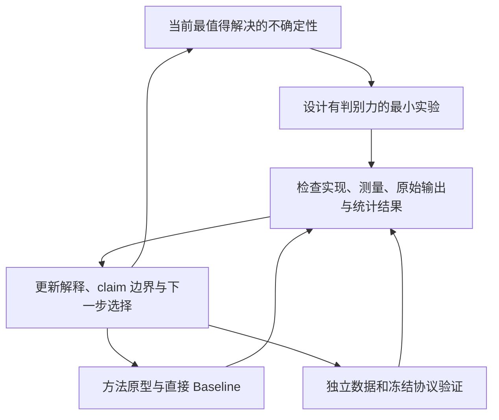

# 本地实验 Agent：研究授权、初步实验与工程备忘

> **更新：2026-10-30。你是负责发现问题、设计实验和迭代方法的研究者，不是执行预写方案的脚本。**
> 题目保持为纯文本单轮／多轮角色对话的人设一致性，主要技术视角为 **A：RL 与角色推理；B：Persona Probes 与激活控制**。当前文档提供已有知识、资源入口和实验起点，不规定最终机制、Loss、数据配比、Probe 层位或成功曲线。

## 一、接手时掌握什么，之后可以自主决定什么

先读 [RESEARCH_IDEAS.md](RESEARCH_IDEAS.md) 的研究问题与候选机制，再读 [DISCUSSION_GUIDELINES.md](DISCUSSION_GUIDELINES.md) 的边界和证据要求。按当前问题查 [资源地图](docs/RESOURCE_ATLAS.md)、[文献索引](docs/LITERATURE.md) 和 [ROADMAP.md](ROADMAP.md) 相关章节，不必把 113 篇文献逐一重读完才开始实验。继续已有工作时，优先检查最近的实验记录、运行状态与未解决问题。

### 1. 不变的边界

核心是自然角色对话中的设定忠实、多轮保持和自然表达；不能缩成孤立二选一任务，也不强行扩展到游戏引擎等旁支。遵守数据许可、测试独立性、公平比较与真实报告，不用训练裁判作为最终唯一证据。

日常使用多台 4×A100／Pro 6000；周末可用 2–3 台 8×H20，单卡 96GB。训练与高频评测保持本地开源闭环，不依赖昂贵闭源 API；只在已有预算内对极少量离线任务使用廉价 API。使用现成数据，避免繁重人工标注和从零建设大型 Benchmark。实际部署是否同驻、跨节点分服务或缩小并发，由测速与资源可用性决定，不保证某个模型组合必然装得下或在几小时内跑完。

### 2. 授权的自主探索

你可以调整数据、采样规模、模型、格式、裁判、奖励、训练框架、Probe 读出、干预方法与实验顺序；可以放弃原文候选、提出未列出的方法，也可以用小规模训练而非纯推理区分机制。A、B 可独立推进，不要求把所有组件合并。调整应留下简短理由和证据，不需要每个参数都请示。

改变主干或突破硬预算需要用户确认。正式改写 `RESEARCH_IDEAS.md` 仍遵循用户授权；将新发现、反例和方法建议先写入实验记录，不应因等待方案文档改版而停下已授权范围内的探索。

## 二、研究循环：下一步做什么，取决于上一批证据



E0、E1、E2 分别指诊断、方法探索、独立验证，不是单向闯关。初批可以只做最有判别力的两三项；无需先铺满模型×数据×裁判×层位的矩阵。冻结底座做激活分析不排斥训练线性 Probe；一个有控制的小 SFT／DPO／RL 实验也可能是更好的诊断工具。

一个实验开始前用几句话说明：**要区分的解释、关键对照、观察指标／真实文本、不同结果会改变什么决定**。执行后记录它实际支持什么，而不是只写有没有涨点。成功、失败、相反结果和暂时无法区分都可以推进研究；并非每个结果都自动有论文价值。

如果简单 Baseline 已解决当前子问题，就以它为新的比较起点，继续寻找有证据的人设一致性难点；不要为了保住复杂方案而削弱 Baseline，也不要因一项假设失败就否定整个主干。

## 三、初批实验菜单：保持具体，但不要机械照表全跑

**可直接动手的一组跨阶段实验**：对 HER 式双层思考，从 `<system_thinking>` 的设定选择、`<role_thinking>` 的转化到最终台词分别做对照；对出现空洞回答的候选，比较 APC-only 与加入回应质量约束后的真实输出；对轻微出戏的自生成历史，测试下一轮能否恢复人物特征。这三种属于不同切口，不要求同时开展，优先选择能解释当前失败的一个。无独白裁判、锚点配对、助手负锚点、跨轮 NLI 与按需 Steering 都是候选，是否使用请参照研究想法文档的适用条件和风险。


建议先跑通一个底座、一个数据子集和一条可检查的评分路径。Qwen3-8B 是已有代码适配较多的起点；CoSER-8B、Qwen2.5-7B-Instruct 或 HER-32B 可在需要时加入，而非每项都必跑。

| 问题 | 可采用的最小对照 | 判读与后续方向 |
| --- | --- | --- |
| 风格好是否掩盖设定违背？ | APC 设定检查与整体角色评价看同一批自然回复；抽读评分分歧 | 若差距真实，再探索奖励／思考；若由抽取和 NLI 错误造成，先修测量 |
| 多轮下降从哪里来？ | CoSER／Persistent Personas 的固定前缀，加少量自生成历史；记录 Profile 是否被截断、问题与 token 长度 | 不预设一定下降；区分历史累计、信息可见性、话题难度与合理角色变化 |
| Thinking 帮了台词还是影响裁判？ | 分开测试生成时改变思考策略、固定台词只改变裁判可见独白；控制长度与候选顺序 | 偏差成立才针对它设计奖励；Answer-Only 也需检查域偏移和自然度评价 |
| 好候选缺失，还是裁判识别不了？ | 困难开发前缀多次采样，统计候选质量、组内方差、评审分歧 | G=8 是一个起点，不是定律；先排查评分噪声和实现，再决定是否做探索改进 |
| 隐藏状态有无额外预测信息？ | 固定 Profile 的成功／失败样本，预生成激活与同信息条件的非表征基线 | 发现信号再检查跨角色稳定性或干预；没有预期变化时可以修正 Probe、解释或优先级 |

百级单轮样本、几十段对话、若干历史位置和少量成对裁判实验只是启动量级参考，不是指定配置或时间承诺。先测完整链路的速度、错误与覆盖，再按实际方差和关键决策扩大。多个轮次或同人物的多条回复不能当成完全独立样本；报告角色／作品／对话数及合适的不确定性。

发现可能有价值的方法时，直接做一个能解释作用的原型及必要消融；不必等菜单全部完成。**具体机制候选、风险与反事实切口见 [RESEARCH_IDEAS.md 第五节](RESEARCH_IDEAS.md#五两条主线的开放式方法武器库具体锋利但不规定必做)**。早期方案可改，确认性比较时冻结数据与协议。不能用反复调过的 E0 样本充当未经触碰的 E2 测试。

## 四、数据、裁判与代码的初步信息

**本节保留前期源码／公开资产审查所得信息，包括 Gemini 加入的工程备忘。它们是 2026-10-30 的审查线索，不是已完成的端到端复现；本轮仅修订文档。启动相关模块时核对最新 commit、文件、权重版本及实际行为即可，不要求先完成全领域审计。**

### 4.1 数据与格式

| 资源入口 | 可直接利用的基础 | 适配注意点 |
| --- | --- | --- |
| [HER-Dataset](https://huggingface.co/datasets/ChengyuDu0123/HER-Dataset)（RP-025） | `full_info`、`clean`、`sft_multi_turn`、`sft_single_turn` 等配置；公开说明中后两者约 76.8k／342.4k | 单轮展开与多轮样本并非独立来源，按原对话／作品溯源；真实样本数以选定 revision 加载结果为准 |
| [CoSER](https://huggingface.co/datasets/Neph0s/CoSER)（RP-013） | ShareGPT 训练数据、人物与场景，多轮测试入口 | 分清对白、动作、心理活动和 narrator；排查与 HER 的共同作品及对话，不把总训练量重复相加 |
| [RoleMRC](https://huggingface.co/datasets/Junrulu/RoleMRC)（RP-021） | 角色与指令监督、SFT／偏好数据 | 曾发现 `conversations` 与 `prompt/chosen/rejected` 混装导致自动加载 schema 冲突；按文件／配置分别加载 |
| [APC](https://github.com/KomeijiForce/Active_Passive_Constraint_Koishiday_2024)（RP-017） | 原子设定、相关性与 NLI 数据／权重 | 适合细粒度检查，不作为完整人物语料或整体质量真值 |
| [RAR 数据](https://huggingface.co/datasets/Toyhom/thinking_in_character_datas)／[VeriRole](https://github.com/FrontierLabs/VeriRole)（RP-024／027） | 角色思考、偏好与设定线索监督 | 可按需要加入；VeriRole 训练 JSON 公开不代表完整训练实现公开 |
| [CharacterBench](https://github.com/thu-coai/CharacterBench)／[Persistent Personas](https://github.com/peluz/persistent-personas)（RP-087／061） | 综合角色评价／长历史保持 | 优先作为评价资源，分别保留开发与确认性验证用途 |
| [Belief Probes](https://github.com/BenSturgeon/persona-belief-probes-submission)／[Too Nice](https://github.com/aryashah2k/Quantifying-Agreeableness-Driven-Sycophancy-in-Role-Playing-Language-Models)（RP-032／036） | 质询与迎合压力、表征实验参考 | 真实／角色信念、宜人性、迎合、OOC 不可混成一个自动标签 |

**统一 Schema 的原则比字段名重要。** 保留来源及原始 ID、作品／角色／对话、语言、Profile 原文、场景、messages、当前轮与历史模式；把系统思考、角色心理、动作和最终台词分开保存。原始数据可回溯，转换器可复现；先支持实际用到的来源，不为了理想 Schema 建造大平台。

只在 APC 需要时追加 `persona_facts` 视图，优先利用已有原子设定或简单分段。复杂句可本地离线分解，但保留原文依据、条件和时间；无法可靠分解就跳过该辅助检查，不删原始 Profile，也不把跳过视为满足。原子化不能偷看目标回答或未来对话来补充人物信息。多轮问题涉及代词／省略时，先核查判别器输入是否能表达上下文，不能把超长历史直接塞进短文本分类器。

HER／CoSER 是主训练池候选，RoleMRC 为辅助候选，RAR／VeriRole 为思考监督候选；此前讨论的 50/30/20 不是硬性配比。按来源重合、人物覆盖、语言、难度与 token 预算决定采样。测试泄漏按实际 claim 定义：未见角色泛化应按角色／作品隔离；同角色新场景协议可以存在，但不得声称角色未见，也不得混入测试对话或答案。

### 4.2 本地裁判：先验证接口与信号，再决定在线比例

**APC。** 两个权重入口为 [relevance](https://huggingface.co/KomeijiForce/deberta-v3-large-relevance-12character) 与 [NLI](https://huggingface.co/KomeijiForce/deberta-v3-large-nli-12character)。输入分别涉及人物＋设定＋问题，以及人物＋设定＋问题＋回复；标签映射按官方模板／代码确认。前期检查见到 `score.py` 逐条循环、`.to("cuda:0")` 和设备硬编码。批量 NLI、可配置设备、`eval()`／无梯度推理和相关性缓存是合理改造起点，不是已经实测的吞吐保证。

缓存键应覆盖实际输入、Profile／模板版本和判别器版本，而不仅是人物名字。跨候选可复用不依赖候选的相关性结果。按语言和新角色校准；多语言模型与英文 DeBERTa 不能默认为同等可靠。长 Profile 的全量检查或筛选可由 Agent 选择，但只检查 top-k 主动设定会漏掉被动矛盾，需记录覆盖与漏检。原始 APC 分数和移位分数的区别见 [研究方案](RESEARCH_IDEAS.md)；同时保留主动体现、被动矛盾、未检查／不确定条目，防止少说话或大量无关设定稀释错误。

**HER-RM-32B。** [权重](https://huggingface.co/ChengyuDu0123/HER-RM-32B)与[实现](https://github.com/cydu24/HER)提供成对生成式评价：角色背景、历史和两个候选，经原则／分析生成比较结果。它不是开箱即用的单回复标量头；完整输出字段、平局与无效输出的处理以选定版本为准。G=8 全量两两比较有 28 对，在线成本应先实测。可以试固定锚点、稀疏比较、离线偏好筛选或与快判别器分工，不指定唯一方案。

原生候选可包含 `<role_thinking>`，适合做固定台词的可见性实验。分开测候选顺序、独白长度、匹配／不匹配独白与实际台词质量；仅发现分数变化还不能证明“被骗”。Answer-Only 同样需要校准，不能称为已经去除全部偏差的裁判。

**CharacterJudge 与 CharacterRM。** [CharacterJudge](https://huggingface.co/thu-coai/CharacterJudge)属于 CharacterBench，公开配置约为 Qwen2 系 8B；[CharacterRM](https://huggingface.co/morecry/BaichuanCharRM)属于 [CharacterEval](https://github.com/morecry/CharacterEval)，是 Baichuan 系，使用其专用维度与输入格式。两者不是同一模型，不可绕过官方构造流程随意传一个字符串就认为协议一致。可用于交叉评价，但模型家族、训练数据和共同偏差也影响证据独立性。

**在线奖励的基本检查。** 先检验组内候选是否在可比协议下被评分；部分候选没有重裁判分数不能直接记成零，按快裁判筛选也可能改变样本分布。记录调用／筛选规则、有效输出率和尺度，测试简单方案后再决定更复杂的组合。文本输入里的思考／答案解析失败、服务超时和模型质量低要分开记录，不应混成负奖励。

### 4.3 代码库与复现边界

| 仓库 | 前期源码审查线索 | 合理处理方式 |
| --- | --- | --- |
| [CRPO](https://github.com/Toyhom/CRPO)（RP-039） | `train/run_rl_qwen3_8b_crpo.sh` 进入 EasyR1 后的相对路径与根目录 `script/config_crpo.yaml` 不匹配；配置引用的 `CharacterTrain_RL_expand.json`、`CharacterTrain_RL_Eval.json`、`roles_2_class_k=7.json`、`character_free_format.jinja`、`character.py` 未在当时文件树找到 | 核对当前树后修路径、补数据／模板／奖励；`core_algos.py` 和批量奖励管理器可作实现参考，但代码存在不代表公式与整链路已验证。缺项重建应标为适配 Baseline，不宣称一键复现原分数 |
| [MOA](https://github.com/ChonghuaLiao/MOA)（RP-040） | TRL／OpenR1 系实现，不是 EasyR1；有硬编码缓存路径、空奖励 URL、外部服务和并发重试设置；训练预处理涉及 `messages`、`thought`、`kn_example`、`ln_example`、`kn_score`、`ln_score` | 按实际任务适配数据和本地奖励；其剥离思考后评价可作对照。不要盲目合并两套训练框架，也不要把通信失败当成角色质量零分 |
| [HER](https://github.com/cydu24/HER)（RP-025） | 数据、模型、RM、处理与评测代码已有入口；`<system_thinking>`／`<role_thinking>`／`<role_action>` 与 Qwen 原生 `<think>` 不同 | 先复用需要的资产，测试序列化、停止条件、历史思考可见性与当前台词解析，再决定是否复现完整训练链 |
| [PERSONA](https://github.com/xcfcode/persona)（RP-068） | `generate_vec.py` 与 `activation_steer.py` 提供对比向量和 HF Forward Hook | 向量在目标模型上重提取，检查 dtype／device／层位；HF 生效不代表直接兼容 vLLM／分布式 rollout |
| [Belief Probes](https://github.com/BenSturgeon/persona-belief-probes-submission)（RP-032） | 有真值读出、质询及激活提取；部分流程涉及 Modal／外部 API，README 提醒 vllm-lens 与 HF 层号约定不同 | 借用必要方法并本地化；原真值 Probe 不等于已训练好的 OOC 检测器，读出约定需小样本交叉验证 |

CRPO 的批量奖励调用在前期审查中为 `reward_fn(responses, ground_truth, prompts)`，返回分项字典；接入当前 checkout 时再验证接口、角色分组、anchor 数量和各分项如何进入优势。不要将“新增一个 reward 函数”误认为已经完整复现 CRPO。MOA 的数据字段和思考字符串解析也应以运行测试而非 README 推断。

原始 CoSER GCA 的论文分数依赖指定 GPT-4o judge 版本，参见[官方说明](https://github.com/Neph0s/CoSER#evaluation)。本地 judge 可以用于统一比较，但要明确是新的评审协议，不直接和论文旧分数相减。其他模型／裁判替换同理。

## 五、Persona Probe 的可修改起点与必要对照

本节保留足够的技术起点，不预先承诺一定存在可用的人设方向。

### 5.1 层与 Token：生成前、思考中、台词前的读出要分清

在目标 checkpoint 配置确认层数和维度。前期核查的 Qwen3-8B 为 36 层、隐藏维度 4096，可先选若干浅／中／深层，例如 **0 基 Transformer block 索引 6、12、18、24、30、35**；这只是便于起步的扫描集合，不表示这些层已知最优。换底座、训练 checkpoint 或工具后需重新验证向量与坐标，不能直接跨模型混用。

| 位置候选 | 适合回答的问题 | 信息边界 |
| --- | --- | --- |
| 最后一条用户消息末尾 | 生成前角色条件与当前状态是否可读出 | 明确实际 token、模板和 padding，不与 assistant 起始符混用 |
| Assistant prefill 末尾、首个生成 token 前 | 实际生成边界的下一步行为预测 | Qwen thinking 模板可能改变边界；保存真实 token ID |
| `</system_thinking>` 后／导演段末尾 | 已生成的导演规划是否提供了可用角色线索 | 需与导演文本本身的内容、长度、标签位置配对比较 |
| `</role_thinking>`（或原生 `</think>`）后、台词首 token 前 | 演员思考结束时的读出是否预测后续台词风险 | 同一 prompt 下不同思考轨迹可形成不同状态；这是**思考后的条件预测**，不是思考前预测 |
| 台词若干 token／整句平均 | 输出后的表征与文字特征分析 | 不能用来证明在回答出现前就知道它会出戏 |

HF `hidden_states` 含 embedding 槽，block hook 与最终归一化输出也需核对；不同库的层号标签相同不代表同一张量。只提取必要层和位置并转存 CPU，避免保留长上下文所有层的激活。先用少量样本验证 Hook 和常规前向的对齐，再扩展。

### 5.2 正负样本与标签

“同题角色条件减普通助手条件”的差向量可以作为角色采纳的起点，但可能主要编码提示内容／格式，不能直接叫忠实度方向。更接近本项目的问题是：**同一 Profile 与任务条件下，哪些生成前激活与后续实际出戏有关？**

可以用实际成功／失败或连续质量分数构造读出任务，标签来源和不确定性需记录。**三个时间位置必须分别理解**：

- **固定同一 prompt／checkpoint 的 P0/P1（生成前）**：若尚无任何随机采样 token，常规确定性前向的状态相同；仅靠不同采样种子随后得到不同台词，不能反过来宣称 P0 已经区分了这些随机结果。此时可估计该前缀的出戏风险分布。
- **同一角色、不同对话历史／轮次的 P0/P1**：输入前缀已经不同，例如第 1、10、20 轮或用户诱导后；此时可以研究生成前角色表征是否变化，以及是否预测后续行为。要控制历史长度、话题、Profile 可见性与来源。
- **固定起始 prompt、但不同采样 `<think>`／`<role_thinking>` 后的 P2**：因为生成的思考轨迹不同，台词前隐藏状态也可能不同；这是值得研究的**thinking-to-answer** 预测窗口。须与只读 thinking 文本／思考长度的预测器对照，不把已生成的思考信息称为“思考前预警”，也不把相关性直接称为思考改变表征的因果证据。

按原对话、人物／作品分组划分，避免相近前缀泄漏。可用线性分类／回归和简单差向量，不必立即引入 SAE 或复杂网络。非表征基线匹配预测时间点：P0/P1 使用历史文本、长度、既往评分及当时可计算的分布特征；思考后 P2 **还须加入 thinking-only 文本基线**；当前完整台词的 RM 分数与输出熵只能用于事后或相同信息条件的比较。比较不同阶段激活时，也要匹配采样与长度、特殊分隔 token 和各段可见信息。

自动裁判标签不是真值。优先检查标签冲突、无效输出和关键实例，避免 Probe 只学会预测某个 judge 的偏好。跨 checkpoint 比较时同时考虑固定读出与重新拟合的差异，不把坐标变化直接解释为角色信息消失。

### 5.3 因果与行为：由证据决定是否继续干预

若跨人物和独立样本上出现稳定预测信号，可优先做**阶段定点干预**：例如替换有依据的导演规划、匹配长度重采样演员思考，再比较最终台词；或在经校准的出戏风险点做轻量 patching／steering。控制组包括不干预、随机／非目标方向、相同预算的普通重锚定、始终干预和随机触发。评估台词忠实度、自然度、重复与指令能力；阈值与干预强度在开发集选择。若 Probe 可读出设定而输出仍出戏，继续检验“信息在却未被用”，不要直接宣称某个助手轴已经在因果上压倒人设。

不要求马上把 Hook 接进在线 RL。若后续用激活引导改变 rollout 分布，需要重新检查行为策略、log-prob 与 on/off-policy 假设，不能直接将受干预样本当作原策略采样。

## 六、如何留下可接续的证据，而不是增加文档负担

可使用一个 `EXPERIMENTS_LOG.md` 加机器可读结果目录；已有合适结构就复用。不要为每个想法新建多份路线图，也不必每次重写全部方案。

一条有用的实验记录可采用下列简短格式，字段可按实际任务精简：

```text
问题／竞争解释：
本次改动与关键对照：
数据与划分／模型与代码版本／配置或运行 ID：
原始输出与指标位置，错误、成本和不确定性：
支持的 claim／仍不能支持的解释：
决定：继续、调整、扩大、暂缓或检查测量；理由：
```

重要结论配代表性实例和反例，抽查数量按风险而定，不机械要求每次打印固定 10–20 条。训练日志至少能追踪数据、rollout、评分、更新与 checkpoint；本地裁判记录有效输出率、吞吐、显存和等待成本即可，不先搭建复杂平台。

扩大实验的依据是当前信号值得复验或方法值得比较，而不是所有待办都已完成。暂缓的依据是证据不足以支持当前投入或已有更值得区分的解释，不是某篇论文出现相同关键词。最终验证的范围应覆盖实际 claim：自然角色对话仍是主体，长期保持、未见角色泛化或因果解释各自需要相应证据。

**最终交付不应只是“执行完了原方案”，而应清楚说明：实验让我们新知道了什么、哪些假设改变了、什么方法实际改善了人设一致性，以及这些结论在哪里成立、在哪里还不成立。**
