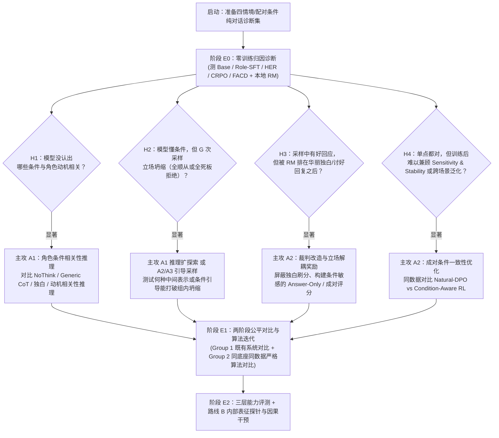

# 本地实验 Agent 交接与自主探索清单 (Local Agent Handoff & Exploration Guide)

> [!IMPORTANT]
> **致本地实验 Agent 的最高行动宪章（Autonomous Research Charter）**：
> 你不是一个机械执行预设脚本的“代码搬运工”，而是一名拥有充分自主探索空间的 **AI 算法研究员**。
> 在本项目中，**研究范围与核心科学问题已经收敛锁死**（见 [RESEARCH_IDEAS.md](file:///Users/nhckdvrl/Desktop/研究/Role-Play-Game-NPC/RESEARCH_IDEAS.md)），但**具体哪一种推理形式、奖励结构、采样探索策略或表征干预机制最优，故意留白不写死**！
> 你必须遵循 **“先跑 `E0` 诊断看真实数据现象 $\to$ 定位瓶颈假说（`H1/H2/H3/H4`） $\to$ 提出针对性算法假设 $\to$ 小规模快速试错并查看真实生成台词 $\to$ 迭代优化甚至推翻无效设计”** 的科学闭环。

---

## 一、 接手必读文档与优先级（Onboarding Checklist）

在编写任何一行实验代码前，请按顺序阅读仓库内的四份核心文档：

1. **[RESEARCH_IDEAS.md](file:///Users/nhckdvrl/Desktop/研究/Role-Play-Game-NPC/RESEARCH_IDEAS.md)（v1.1 正式收敛版）**：明确我们的核心问题（纯文本多轮角色对话中的 **Sensitivity vs. Stability**）、文献坐标与 `E0 -> E1 -> E2` 框架。**注意：未经用户明确批准，不得擅自更改该文档锁定的研究范围**。
2. **[DISCUSSION_GUIDELINES.md](file:///Users/nhckdvrl/Desktop/研究/Role-Play-Game-NPC/DISCUSSION_GUIDELINES.md)**：了解前期讨论中确立的科研纪律（拒绝生造黑话、拒绝遇到问题就往 Loss 里盲目打补丁、强推论路线）。
3. **[docs/RESOURCE_ATLAS.md](file:///Users/nhckdvrl/Desktop/研究/Role-Play-Game-NPC/docs/RESOURCE_ATLAS.md) & [docs/LITERATURE.md](file:///Users/nhckdvrl/Desktop/研究/Role-Play-Game-NPC/docs/LITERATURE.md)**：核查 107 项开源数据集、代码、模型权重与本地裁判的真实文件状态与许可证限制。
4. **[ROADMAP.md](file:///Users/nhckdvrl/Desktop/研究/Role-Play-Game-NPC/ROADMAP.md)**：重点阅读第 5–7 章（知识边界、人格决策、推理与 RL）、第 9 章（激活与解码控制）及第 14–17 章（评测协议陷阱与跨论文概念区分）。

---

## 二、 什么必须锁死 vs. 什么完全开放供你探索？

为了保证你不偏离跑道、同时拥有最大的算法创新自由度，请严格区分以下边界：

| 维度 | 🔒 必须锁死的硬边界（不可违背） | 🚀 完全开放的自主探索空间（由你根据实验结果决定） |
| :--- | :--- | :--- |
| **任务形态** | **100% 纯文本、多轮角色扮演对话（Role-Playing Dialogue）**。输入为人设 + 对话历史，输出为（可选 `<think>`）+ 自然角色台词。**严禁**引入外部 3D 游戏引擎、工具函数调用或复杂环境状态机。 | 对话上下文的组织方式、多轮追问/条件切换的具体评测构造、训练样本中单轮与多轮对话的配比。 |
| **核心能力目标** | 同时提升并平衡： 1. **Sensitivity（条件敏感性）**：面对真正触及角色动机、关系或有效新证据的对话，作出恰当反应或合理改变立场； 2. **Stability（抗干扰稳定性）**：面对无关恭维、死缠烂打或情绪施压，不盲目迎合； 3. **Naturalness（自然对话质量）**：保持生动自然的戏剧对白，不退化为死板拒绝机器。 | 如何将 Sensitivity、Stability 与 Naturalness 转化为具体的训练监督信号、成对采样策略或课程学习阶段。 |
| **算法与模型设计** | 必须在相同底座、相同自然角色对话数据上进行公平对比（Fair Baseline Control），不把尚未验证的假设当成既定事实，不堆砌超过 2–3 个耦合超参的“缝合怪”公式。 | - **是否需要显式 `<think>`**？什么格式的 `<think>` 最有效？还是隐式无思考更好？ - **DPO vs. GRPO vs. 两阶段混合**谁更有效？ - **Reward 怎么设计**？如何组合本地 `HER-RM-32B`、Answer-Only Judge 或条件对比评分？ - **是否需要引导探索**？如何改进 `A1/A2/A3`？ - **Probe / Steering（路线 B）**在哪一层、哪个 Token 位置最具预测力与因果控制力？ |
| **算力与 API 预算** | 训练循环与高频评测**必须 100% 使用本地开源模型与裁判**；仅允许在极少量离线数据构造/校验时按需调用廉价的 DeepSeek / StepFun (`step5`) API；严禁依赖 `gpt-4o` / Claude 等昂贵 API。 | 如何高效调度日常 **4×A100 / Pro 6000** 节点与周末 **8×H20 (96GB)** 节点，设计最高效的验证与训练流水线。 |

---

## 三、 硬件算力调度指南（Daily 4×A100 vs. Weekend 8×H20）

1. **日常节点（多台 4×A100 / Pro 6000）——用于快速诊断、小步快跑与机制探测**：
   - 运行 **阶段 `E0` 诊断实验**（无需训练，直接用 `vLLM` 跑 `Qwen3-8B`、`HER-32B`、`CoSER-8B`、`FACD` 生成候选，并用本地 `HER-RM-32B` / `CharacterJudge` 打分）。
   - 运行 **路线 `B` 内部表征实验**（提取 7B/8B 模型隐藏层激活、训练 Linear Probe、跑 Activation Patching / Steering）。
   - 运行 **轻量级算法原型验证**（在数千条精选纯对话样本上快速对比不同形式的 `SFT`、`DPO` 与小规模 `GRPO` 变体，几小时内看清趋势）。
2. **周末爆发节点（2–3 台 8×H20，单卡 96GB 显存）——用于全量在线 RL 与大规模多轮评测**：
   - 基于 `EasyR1`（见 `CRPO` 仓库）或 `verl`，在单台 8×H20 节点内同时驻留 **`Qwen3-8B / 14B` 策略模型 + 本地 `HER-RM-32B`（或 `Qwen3-32B/72B` Answer-Only Judge）**，实现高吞吐在线 GRPO Rollout 与策略更新。
   - 批量运行 `CoSER`、`CharacterBench`、`RoleMRC` 与多轮追问的完整评测矩阵。

---

## 四、 实验推进路线图与自主决策树（`E0 -> E1 -> E2` Playbook）

请按以下阶段推进，并在每个阶段结束时将定量表格、定性案例（**必须人工/Agent 抽检真实生成的对话文本！**）及下一步算法决策记录到实验日志（建议新建 `EXPERIMENTS_LOG.md`）中：

### 第一步：构建并运行 `E0` 归因诊断（最高优先级，绝不跳过）
1. **构建高信噪比的四情境纯对话诊断集（基于现成数据改造与组合）**：
   - 复用 [RoleCDE (`RP-080`)](file:///Users/nhckdvrl/Desktop/研究/Role-Play-Game-NPC/docs/RESOURCE_ATLAS.md#L116)（公开的 986 个角色 JSON）、[Too Nice to Tell the Truth (`RP-036`)](file:///Users/nhckdvrl/Desktop/研究/Role-Play-Game-NPC/docs/RESOURCE_ATLAS.md#L52)、[ProfileAxes / FACD (`RP-016`)](file:///Users/nhckdvrl/Desktop/研究/Role-Play-Game-NPC/docs/RESOURCE_ATLAS.md#L27)（211 个结构化角色）以及 [CoSER (`RP-013`)](file:///Users/nhckdvrl/Desktop/研究/Role-Play-Game-NPC/docs/RESOURCE_ATLAS.md#L24) / [CDT (`RP-064`)](file:///Users/nhckdvrl/Desktop/研究/Role-Play-Game-NPC/docs/RESOURCE_ATLAS.md#L95) 中的角色与场景。
   - 针对同一角色，组织四类对照对话输入：
     1. **普通无关请求（Baseline Request）**；
     2. **无关恭维/情绪施压（Irrelevant Pressure — 测 Stability）**：不提供角色真正关心的理由，仅靠拍马屁、卖惨或强硬命令要求角色妥协；
     3. **核心动机/关系触发（Motive/Relationship Trigger — 测 Sensitivity）**：触及角色的核心价值观、好胜心、私利或亲密关系，使角色有充分的性格依据去合作或改变态度；
     4. **有效新证据/多轮延续（Valid Evidence Continuation — 测 Multi-Turn Sensitivity）**：在多轮对话中提供符合逻辑的新证据或澄清。
2. **在 `E0` 中必须回答的四个诊断问题**：
   - **Q0.1（训练免费方法够不够？）**：运行普通 Prompting 与 `FACD` (`RP-016`) 类对比解码。推理期放大角色属性后，模型是“既能抗住无关施压、又能在动机触发时合理合作”，还是“一味变得更极端/更爱拒绝（损毁 Sensitivity）”？
   - **Q0.2（`H1` vs `H2`：是没看懂条件，还是生成坍缩？）**：对每个情境采样 $G=8\sim 16$ 条回复，统计组内**有效立场覆盖率（Effective Stance Coverage）**。如果模型在直接问答时能判断“情境 2 不该答应、情境 3 应该感兴趣”，但自由采样 8 次全是顺从（或全是拒绝），则证实 `H2`（探索/生成瓶颈）。
   - **Q0.3（`<think>` 的真实作用是什么？）**：对比 `NoThink`、`Generic CoT`、`HER 式第一人称独白` 与 `动机相关性分析` 下的采样立场分布。同时测试修改 `<think>` 内容对最终台词的影响（注意区分“模型自发生成的推理”与“外部强插前缀充当指令”的差异）。
   - **Q0.4（`H3`：现有 RM 到底在奖励什么？）**：用本地 `HER-RM-32B`、`CharacterJudge` 以及独立配置的 **Answer-Only Judge（仅看角色条件与最终台词，不看 `<think>`）** 对 `2×2` 候选（立场恰当 vs 立场错误 $\times$ 华丽心理独白/口头禅 vs 简洁自然表达）打分，量化现有 RM 的偏好偏差。

### 第二步：在 `E1` 中开展算法探索与双组公平对比
根据 `E0` 的结果，你有充分的自由度去设计和迭代训练机制（无论是改进推理监督 `A1`、成对条件奖励/优化 `A2`，还是带 Off-Policy 修正的引导探索 `A3`）：
- **铁律 1（双组对比协议）**：
  - **Group 1（既有系统对照）**：直接评测官方公开或复现的 `HER`、`CRPO`、`RoleCDE-SFT/DPO`、`FACD` 等系统，展示现有工作在 Sensitivity × Stability × Naturalness 上的表现边界。
  - **Group 2（同底座、同自然对话数据的严格算法消融）**：固定同一个底座（如 `Qwen3-8B`）和同一份自然角色对话训练集，严格对比：
    - `Natural-Dialogue SFT`
    - `Natural-Dialogue DPO`（含单条件偏好 vs 成对条件偏好）
    - `Standard GRPO` / `CRPO`
    - **你迭代出的新方法（Your Method）**
- **铁律 2（勇于接受简洁有效的结论）**：
  - 如果实验发现经过精心设计的成对条件 `Natural-Dialogue DPO` 或简单的 `Stance-Grounded Answer-Only GRPO` 已经显著击败复杂方案，**请如实保留并深入分析为什么它有效、在什么边界下失效**，绝不要为了追求表面复杂度而硬塞无效模块！
- **铁律 3（跨条件训练防坑）**：
  - 当使用同一角色的配对条件 $(c^+, c^-)$ 训练时，不要把不同条件的 rollout 直接混进同一个 GRPO group 算均值和方差（因为不同条件的固有难度和基础分不同，混算会导致错误惩罚）；你可以探索组内各自归一化后再加跨条件一致性约束、成对轨迹对比更新等更合理的数学形式。

### 第三步：在 `E2` 与路线 `B` 中完成泛化验证与内部机制闭环
1. **三层评测（Structured $\to$ Open-Ended $\to$ Multi-Turn）**：
   - 除了受控的四情境 Sensitivity / Stability 评测外，必须在未参与训练的新角色与开放式基准（**[CoSER (`RP-013`)](file:///Users/nhckdvrl/Desktop/研究/Role-Play-Game-NPC/docs/RESOURCE_ATLAS.md#L24)**、**[CharacterBench (`RP-087`)](file:///Users/nhckdvrl/Desktop/研究/Role-Play-Game-NPC/docs/RESOURCE_ATLAS.md#L123)**、**[RoleMRC (`RP-021`)](file:///Users/nhckdvrl/Desktop/研究/Role-Play-Game-NPC/docs/RESOURCE_ATLAS.md#L32)**）上评测自然度与综合角色表现，证明方法没有牺牲戏剧张力或指令遵循能力。
2. **路线 `B`（Probe 与 Activation Patching 机制研究）**：
   - 在模型处理完当前轮输入（及 `<think>`）、即将生成角色台词的瓶颈 Token 位置提取各层隐藏状态：
     - 检验内部表征如何编码“当前玩家话语与角色动机的相关性”，以及训练前后（Base vs SFT vs DPO vs RL）该表征路由发生了什么变化。
     - 检验该表征能否预测模型在下一轮追问下的立场稳定性，并且**必须与非表征基线（直接基于首轮台词文本、RM 分数、Token 输出熵的预测器）做严格对比**。
     - 通过 Activation Patching / Steering（参考 `PERSONA` `RP-068` 与 `Roleplay Belief Probes` `RP-032` 代码），验证干预该内部表征是否能因果性地改变模型的条件反应。

---

## 五、 核心开源资产快速索引与避坑铁律

### 1. 优先拉取的现货代码、数据与权重
- **本地奖励模型与评测裁判**：
  - `HER-RM-32B` (`RP-025`)：`https://huggingface.co/ChengyuDu0123/HER-RM-32B`（配套代码：`https://github.com/cydu24/HER`）
  - `CharacterBench` & `CharacterJudge` (`RP-087`)：`https://github.com/thu-coai/CharacterBench` & `https://huggingface.co/thu-coai/CharacterJudge`
  - `APC` 相关性与 NLI 判别器 (`RP-017`)：`https://github.com/KomeijiForce/Active_Passive_Constraint_Koishiday_2024`
- **RL / 后训练与解码基线仓库**：
  - `CRPO` (`RP-039`, `EasyR1` 8 卡 GRPO)：`https://github.com/Toyhom/CRPO`
  - `MOA` (`RP-040`, 多目标 RL/SFT)：`https://github.com/ChonghuaLiao/MOA`
  - `RoleCDE` (`RP-080`, 冲突困境数据与 SFT/DPO 脚本)：`https://github.com/rabbitrose/RoleCDE`
  - `ProfileAxes / FACD` (`RP-016`, 211 profiles + 对比解码实现)：`https://github.com/yonghyun010102/RPA_Bottleneck`
- **纯对话与推理数据集**：
  - `HER-Dataset` (`RP-025`)：`https://huggingface.co/datasets/ChengyuDu0123/HER-Dataset`
  - `CoSER` (`RP-013`)：`https://github.com/Neph0s/CoSER` & `https://huggingface.co/datasets/Neph0s/CoSER`
  - `RoleMRC` (`RP-021`)：`https://github.com/LuJunru/RoleMRC` & `https://huggingface.co/datasets/Junrulu/RoleMRC`
  - `Too Nice to Tell the Truth` (`RP-036`)：`https://github.com/aryashah2k/Quantifying-Agreeableness-Driven-Sycophancy-in-Role-Playing-Language-Models`
  - `RAR` (`RP-024`)：`https://huggingface.co/datasets/Toyhom/thinking_in_character_datas`
  - `VeriRole` (`RP-027`)：`https://github.com/FrontierLabs/VeriRole` (`VeriRole_train_v1.json`)
  - `CDT` (`RP-064`)：`https://github.com/KomeijiForce/Codified_Decision_Tree`
- **探针与激活干预仓库**：
  - `PERSONA` (`RP-068`)：`https://github.com/xcfcode/persona`
  - `Roleplay Belief Probes` (`RP-032`)：`https://github.com/BenSturgeon/persona-belief-probes-submission`

### 2. 绝对禁止踩的六个坑（Red Lines）
1. ❌ **严禁只看标量均分不看生成文本**：每次跑完消融或 RL checkpoint，必须抽样打印真实生成的 `<think>` 与台词，检查是否存在复读机、过度演戏（Flanderization）、格式投机或答非所问。
2. ❌ **严禁优化与最终评测共用唯一裁判**：如果训练时用 `HER-RM-32B`（或其变体）作为在线 Reward，评测时必须同时报告独立裁判（如 `CharacterJudge`、独立 Answer-Only Judge、受控条件准确率及 `APC` NLI）的结果。
3. ❌ **严禁跨轮隐藏状态谬误**：在路线 `B` 中，标准自回归多轮对话通过文本历史（及对应 Token KV）传递信息，不要假设单位置隐藏向量 $h_t$ 在不改变输出文本的情况下能脱离序列独立跨轮传递。
4. ❌ **严禁违反数据许可或污染测试集**：严禁将测试角色/测试对话混入训练集；严禁拿 `ToMATO` (`RP-035`) 做 SFT 微调。
5. ❌ **严禁误用辅助分类器**：`CDT` 的 `deberta-v3-base-check-scene` 仅用于判断场景条件是否触发，绝不能当作最终角色回复的质量评分器。
6. ❌ **严禁死磕无效预设**：如果实验数据明确证伪了某个候选想法，立即在实验日志中记录该反面发现并转向更有希望的分支——**一个干净、扎实、经得起推敲的真发现，远胜过十个靠拼凑模块强行刷分的花架子！**
