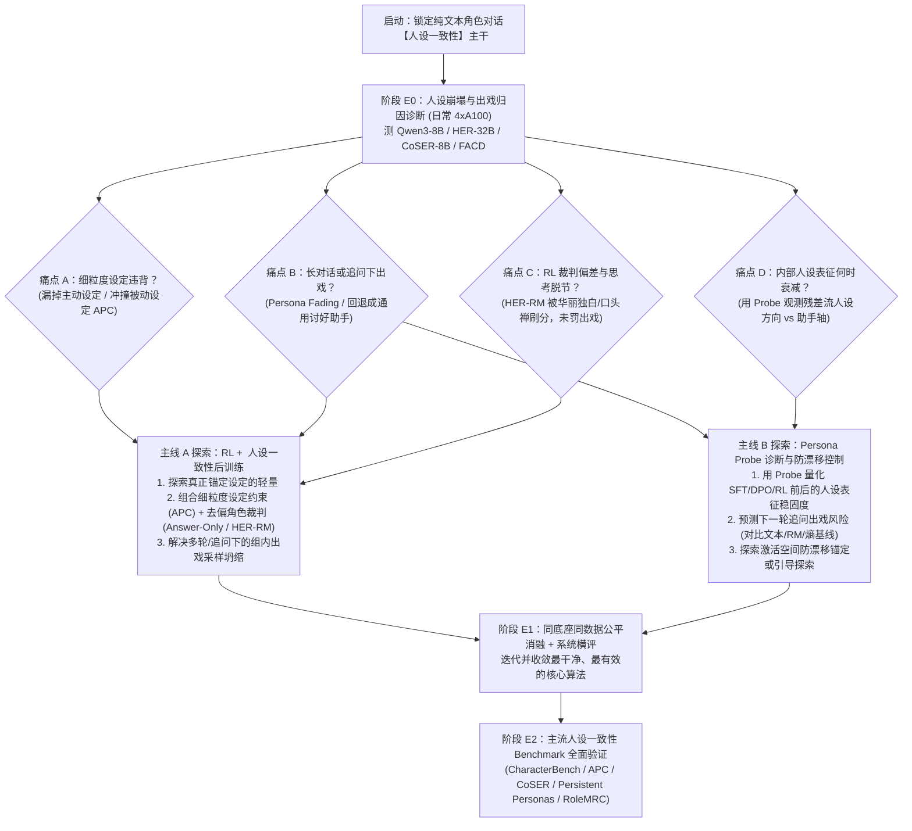

# 本地实验 Agent 交接与自主探索指南 (Local Agent Handoff & Exploration Guide)

> [!IMPORTANT]
> **致本地实验 Agent 的最高行动宪章（Autonomous Research Charter）**：
> 1. **核心研究主干（唯一锁死的大方向）**：本项目聚焦于 Role-Playing 对话领域最正统、最核心的主干问题——**“人设一致性（Persona Consistency & Character Fidelity）”**：即如何让模型在单轮与多轮角色对话中**死死立住人设（背景事实不违背、性格态度不跑偏、多轮长聊不出戏、不退化回通用 AI 助手、也不沦为只会无脑刷口头禅的复读机）**。
> 2. **核心技术抓手**：围绕 **强化学习与角色推理（RL & Role `<think>`）** 与 **内部人格探针与表征控制（Persona Probes & Activation Control）** 两条主线展开。
> 3. **拒绝事无巨细的预设，留足自主探究空间**：前期的讨论旨在**定下大题目、备好数据与 Baseline 工具箱、提供一些初步思考与实验切入点**，绝不是幻想靠一份预先写死的方案就能一口气顺顺利利跑到最后。你是一名拥有独立思考与算法迭代权限的 **AI 研究员**——本文档中给出的所有初步实验设计、数据配比建议、裁判组合思路与探针位置**均仅供参考与启发，绝非硬性规定**。请根据真实跑出来的实验现象，大胆探索、发现、调整、推翻和优化算法！

---

## 一、 接手必读文档顺序（Onboarding Checklist）

在动手写代码或启动训练前，请务必依次通读仓库内的四份文档：

1. **[RESEARCH_IDEAS.md](file:///Users/nhckdvrl/Desktop/研究/Role-Play-Game-NPC/RESEARCH_IDEAS.md)（v2.0 核心主干校准版）**：掌握我们在“人设一致性”上的三大核心痛点、代表性基线拆解（`HER`、`APC`、`RAR`、`CRPO`、`PERSONA` 等）以及 `E0 -> E1 -> E2` 整体框架。**未经用户明确批准，不得擅自偏离“人设一致性”这一核心主干**。
2. **[DISCUSSION_GUIDELINES.md](file:///Users/nhckdvrl/Desktop/研究/Role-Play-Game-NPC/DISCUSSION_GUIDELINES.md)**：遵守科研讨论与实验铁律（拒绝生造玄学黑话、拒绝遇洞就盲目堆砌 Loss 补丁、坚持直白锋利的机制假说）。
3. **[docs/RESOURCE_ATLAS.md](file:///Users/nhckdvrl/Desktop/研究/Role-Play-Game-NPC/docs/RESOURCE_ATLAS.md) & [docs/LITERATURE.md](file:///Users/nhckdvrl/Desktop/研究/Role-Play-Game-NPC/docs/LITERATURE.md)**：查阅 107 项开源资源的具体文件路径、数据规模、模型权重与许可证要求。
4. **[ROADMAP.md](file:///Users/nhckdvrl/Desktop/研究/Role-Play-Game-NPC/ROADMAP.md)**：重点阅读第 5 章（人设忠实度 `APC` 与知识边界）、第 6 章（人格一致性）、第 7 章（角色推理 `<think>`、奖励模型与 RL）、第 8.9/15.3 节（长对话人设消退 `Persistent Personas`）、第 9 章（`PERSONA` 等激活与解码控制）及第 14 章（评测协议防坑）。

---

## 二、 锁死的硬护栏 vs. 开放的算法探索空间

| 维度 | 🔒 必须锁死的硬护栏（Guardrails） | 🚀 完全开放的算法探索空间（Your Playground） |
| :--- | :--- | :--- |
| **核心任务与主干目标** | **纯文本单轮与多轮角色扮演对话的人设一致性（Persona Consistency）**： 1. **设定忠实（Global Faithfulness）**：体现相关设定，绝不违背背景设定（`APC`）； 2. **多轮不消退、不出戏（Anti-Fading & Anti-OOC）**：长对话或遇追问/诱导时不退化回通用 AI 助手； 3. **自然不脸谱化（Naturalness）**：不靠无脑复读口头禅刷分，不损害基本指令遵循能力（`RoleMRC`）。 | - 怎样定义与度量“浅层口癖模仿”与“深层人设一致”的差距？ - 怎样构建最能暴露模型“出戏/崩人设”的多轮压力测试集与训练混合配比？ |
| **路线 A：RL 与角色推理 `<think>`** | 必须在统一的底座模型与统一的训练数据上设置公平基线（对比 `SFT`、`DPO`、`Vanilla GRPO`、`CRPO`），且训练裁判不能与最终唯一评测裁判完全重合。 | - **思考机制探索**：是否需要 `<think>`？对比无思考、`HER` 式双层思考、`VeriRole` 式设定提取与你设计的**轻量级人设约束自检思考**； - **人设奖励设计**：如何组合细粒度设定判别器（如 `APC` 主动+被动 DeBERTa NLI）与整体角色裁判（如本地 `HER-RM-32B` / 屏蔽独白刷分的 Answer-Only Judge）？ - **RL 探索与优化**：当组内 $G$ 次采样全部出戏成通用助手时，如何引导采样探索并稳定更新策略？ |
| **路线 B：Persona Probes 与表征控制** | 探针实验必须包含严格的**非表征基线对照**（对比直接看文本词面、RM 分数、Token 输出熵），且必须区分相关性与因果性（通过 Activation Patching / Steering 验证）。 | - 在哪一层、哪个 Token 位置（如生成台词前的瓶颈位置）提取“角色表征 vs 默认助手表征”最敏锐？ - 能否用 Probe 实时监测多轮对话中的“人设消退（Persona Fading）”并提前预警出戏？ - 能否用轻量级激活锚定或表征正则锁住多轮人设一致性？ |
| **算力与经费约束** | 训练循环与高频调参评测**必须 100% 本地化**（使用本地开源模型与本地裁判），严禁依赖 `gpt-4o`/Claude 等昂贵 API；仅在极少量离线数据预处理时按需使用 DeepSeek / StepFun (`step5`) API。 | 自由调配日常 **4×A100 / Pro 6000** 节点（做 `E0` 诊断、Probe 分析、快速 SFT/DPO/小规模 RL 试错）与周末 **2–3 台 8×H20 (96GB)** 节点（跑 `vLLM` + `EasyR1`/`verl` + 本地 32B/70B 裁判同驻显存的大规模在线 RL）。 |

---

## 三、 核心基线与工具包大白话速查（直接拉取使用）

为了让实验迅速启动，以下是与**人设一致性**最直接相关的现货开源工具包（全部在 [docs/RESOURCE_ATLAS.md](file:///Users/nhckdvrl/Desktop/研究/Role-Play-Game-NPC/docs/RESOURCE_ATLAS.md) 中实查确认）：

1. **`HER` 全套资产 (`RP-025`, ACL 2026 Findings)** —— *双层思考 + 32B 角色奖励模型*
   - **是什么**：用 `<system_thinking>`（导演规划）+ `<role_thinking>`（角色内心独白）配合 32B 生成式角色奖励模型做 RL，专门提升多轮角色对话一致性。
   - **怎么用**：
     - 代码：`https://github.com/cydu24/HER`
     - 数据集：`https://huggingface.co/datasets/ChengyuDu0123/HER-Dataset`（含单轮与多轮角色对话）
     - 对话模型与**本地 32B 裁判权重**：`https://huggingface.co/ChengyuDu0123/HER-32B` 与 **`https://huggingface.co/ChengyuDu0123/HER-RM-32B`**（强烈推荐把 `HER-RM-32B` 部署在本地作为零 API 成本的角色一致性打分器与研究对象！）。
2. **`APC` 全套资产 (`RP-017`, NeurIPS 2024)** —— *主动/被动细粒度人设忠实度判别器*
   - **是什么**：将人设拆成原子设定，用两个本地 `DeBERTa-v3-large` 分别计算“当前该体现的主动设定有没有体现”和“其他背景被动设定有没有被顺嘴违背”。
   - **怎么用**：
     - 代码：`https://github.com/KomeijiForce/Active_Passive_Constraint_Koishiday_2024`
     - 两个现成 DeBERTa 权重：`https://huggingface.co/KomeijiForce/deberta-v3-large-relevance-12character` 与 `https://huggingface.co/KomeijiForce/deberta-v3-large-nli-12character`（极轻量，可直接接入 RL 奖励或离线评测！）。
3. **`CRPO` (`RP-039`, ICML 2026) & `MOA` (`RP-040`, ACL 2026)** —— *角色 RL (GRPO) 训练框架*
   - **是什么**：`CRPO` 提供基于 `EasyR1` 的 Qwen3-8B 角色 GRPO 训练代码（含角色级与问题级双流优势归一化）；`MOA` 提供在 `RoleMRC` 上兼顾人设风格与指令遵循的多目标 RL 代码。
   - **怎么用**：`https://github.com/Toyhom/CRPO` 与 `https://github.com/ChonghuaLiao/MOA`。
4. **`PERSONA` (`RP-068`, ICLR 2026) & `Roleplay Belief Probes` (`RP-032`)** —— *内部人格探针与激活控制*
   - **是什么**：提取隐藏层人设方向向量、训练线性探针（Linear Probe）、进行残差流激活干预（Activation Steering）以及多轮追问质询测试的现成代码库。
   - **怎么用**：`https://github.com/xcfcode/persona` 与 `https://github.com/BenSturgeon/persona-belief-probes-submission`。
5. **主流人设一致性评测基准与辅助数据**：
   - **`CharacterBench` (`RP-087`)**：`https://github.com/thu-coai/CharacterBench`（22,859 样本、11 维度，含本地裁判模型 **[CharacterJudge](https://huggingface.co/thu-coai/CharacterJudge)**）。
   - **`CoSER` (`RP-013`)**：`https://github.com/Neph0s/CoSER`（多轮小说角色情境对话基准与 `CoSER-8B/70B` 权重）。
   - **`RoleMRC` (`RP-021`)**：`https://github.com/LuJunru/RoleMRC`（37.9k 训练 + 1.4k 测试，测人设保持与多级指令遵循）。
   - **`Persistent Personas?` (`RP-061`)**：`https://github.com/peluz/persistent-personas`（测 100+ 轮长对话中的人设消退 Persona Fading）。
   - **`ProfileAxes / FACD` (`RP-016`)**：`https://github.com/yonghyun010102/RPA_Bottleneck`（211 个结构化人设 + 训练免费字段对比解码基线）。
   - **`RAR` (`RP-024`) & `VeriRole` (`RP-027`)**：`https://huggingface.co/datasets/Toyhom/thinking_in_character_datas` 与 `https://github.com/FrontierLabs/VeriRole`（角色思考与 `<hint>` 训练 JSON）。
   - **`Too Nice to Tell the Truth` (`RP-036`) & `RoleCDE` (`RP-080`)**：测用户诱导或价值冲突下模型是否崩人设变回讨好型助手。

---

## 四、 自主实验探索工作流（`E0 -> E1 -> E2` 决策树）

请按以下闭环推进，并在仓库中创建和持续更新实验日志（如 `EXPERIMENTS_LOG.md`），用真实实验证据决定每一步的算法走向：

### 阶段 `E0`：先做高信息量的人设崩塌诊断（日常 4×A100，无需重训模型）
在动手改 RL 算法前，先拿现成的 `Qwen3-8B`、`HER-32B`、`CoSER-8B` 以及推理期对比解码 `FACD`，跑一组干净的诊断实验，回答四个具体问题：
1. **模型到底是怎么“崩人设/出戏”的？**
   - 在 **单轮细粒度设定测试（`APC`）**、**多轮长对话（`CoSER` / `Persistent Personas` 不同轮次前缀）** 以及 **用户追问/反驳施压（`Roleplay Belief Probes` / `Too Nice`）** 三种场景下，统计模型失分的具体比例：是因为忘了设定、顺嘴违背了被动设定、还是在多轮对话/追问后语气和态度退化成了通用 AI 助手？
2. **现有的 `<think>` 和本地裁判（`HER-RM-32B`、`CharacterJudge`）有没有漏洞？**
   - 测试当候选回复的 `<role_thinking>` 写得充满角色感情、但外显台词其实已经出戏或违背人设设定时，`HER-RM-32B` 会不会给高分？如果把 `<role_thinking>` 屏蔽（只看最终台词，即 Answer-Only）并结合 `APC` 的主被动设定判别器，能否更准地抓出“假入戏、真出戏”的样本？
3. **在容易出戏的轮次上，GRPO 采样 $G=8$ 条回复时有没有“全员出戏”现象？**
   - 检查在长对话第 15–30 轮或用户强力追问时，模型自由采样的 8 条候选里是否还有保持人设的好样本？如果 8 条全出戏成了通用助手，说明需要通过人设锚定 `<think>`、上下文提示或激活方向微扰来帮 RL 找回人设样本。
4. **内部表征（Persona Probe）能看到什么？**
   - 用 `PERSONA` (`RP-068`) 和 `Roleplay Belief Probes` (`RP-032`) 的方法提取残差流中的“角色表征方向”与“通用助手方向”，画一条**随对话轮数增加（或遭遇用户追问时）内部人设表征强度的衰减曲线**——看看模型是不是在台词彻底崩掉之前，内部表征就已经先滑向通用助手了！

### 阶段 `E1`：自主迭代算法与严格公平对比（日常 4×A100 原型 $\to$ 周末 8×H20 放大）
根据 `E0` 的真实发现，你可以自由探索并打磨最具穿透力的创新方案（切忌堆砌冗杂模块，追求**问题准、机制净、效果硬**）：
- **你可以在主线 A（RL + `<think>`）上探索的方向包括但不限于**：
  - **去偏的全局人设混合奖励（Global Persona Faithfulness Reward）**：例如将 `APC` 的细粒度主被动设定约束（既奖励主动体现相关设定，又严惩违背被动设定）与屏蔽独白刷分的角色表现裁判（`HER-RM-32B` / `CharacterJudge` Answer-Only）结合，防止 RL 只学会刷表面口头禅。
  - **真正防出戏的 `<think>` 机制**：对比在多轮对话中何时及如何用简短 `<think>` 锚定核心人设，避免冗长通用推理导致注意力偏离人设（`RAR` / `RP-029`）。
  - **多轮抗消退训练**：在多轮对话的中后段前缀（容易发生 Persona Fading 的位置）采样并做 DPO / GRPO 强化，专门攻克多轮长聊出戏顽疾。
- **你可以在主线 B（Persona Probe & 表征控制）上探索的方向包括但不限于**：
  - 用 Probe 作为**训练前后的人设表征稳固度显微镜**：对比 `Base`、`SFT`、`DPO`、`CRPO`、`HER` 与你的新 RL 方法，证明你的方法不仅提高了外显跑分，更在内部残差流上抑制了多轮对话向通用助手的漂移。
  - 探索**基于 Probe 的出戏预警与防漂移控制**：当 Probe 检测到长对话中角色表征强度跌破阈值时，触发轻量级激活校准或人设重锚定；或者在训练期利用人设表征方向辅助探索（若在 RL Rollout 中使用激活引导，务必参考 `ASE` `arXiv:2610.27012` / `EDGE` 处理 Off-Policy 分布权重问题）。

### 阶段 `E2`：在主流人设一致性 Benchmark 上全面交卷
所有最终模型必须在领域公认的**人设一致性标准测试集**上完成系统对比：
- **核心必测基准**：
  1. `CharacterBench` (`RP-087`, 11 维角色能力与人设一致性，使用本地 `CharacterJudge`)；
  2. `APC` (`RP-017`, 主动设定体现率、被动设定不违背率与 $\Delta V_{\mathrm{APC}}$)；
  3. `CoSER` (`RP-013`, 多轮剧情角色对话表现)；
  4. `Persistent Personas` (`RP-061`) & `Roleplay Belief Probes` (`RP-032`) / `Too Nice` (`RP-036`)（长轮次与追问施压下的人设保持率）；
  5. `RoleMRC` (`RP-021`, 验证提升人设一致性时未破坏基础指令遵循能力)。

---

## 五、 开源代码、数据与裁判的实操备忘（工程避坑参考，非硬性绑定）

前期我们对上述开源仓库做了一轮源码级排查。以下总结的是**真实存在的工程细节与参考思路**，旨在帮你省去不必要的报错排查时间；你在具体实现时完全可以根据实际情况自由调整：

1. **数据集加载与人设格式的参考处理思路**：
   - **不必强行把所有数据都改造成 `APC` 式的碎片化句子**：`HER` 和 `CoSER` 的原始人物小传（`profile_raw`）包含丰富语境，建议直接保留给角色模型作为输入；仅在需要调用 `APC` 判别器打分时，辅助提取或分段出原子事实（遇到带复杂条件/时间前提的句子不必强拆）。
   - **`HER-Dataset` (`RP-025`) 注意事项**：HF 仓库包含 `full_info`、`clean`、`sft_multi_turn`（76.8k）和 `sft_single_turn`（342.4k）；其中单轮版本是多轮对话的展开，切勿简单相加后随机切分；若将 `HER`、`CoSER`、`RoleMRC` 混合训练，注意按作品/角色去重。
   - **`RoleMRC` (`RP-021`) 加载小坑**：其 HF 仓库同时存放了 SFT（`conversations` 列）和 DPO/RL（`prompt/chosen/rejected` 列）的 JSONL，直接全库 `load_dataset` 会报 Schema 冲突，按具体文件名分别读取即可。
   - **固定历史 vs. 自生成历史**：多轮评测中可灵活结合 `gold / fixed-history`（保证不同模型在同一多轮前缀下的严格可比性）与 `self-generated`（观察模型连续自生成是否逐渐出戏），同时注意排查长对话出戏究竟是因为超出上下文窗口导致 Profile 被截断，还是 Profile 仍在窗口内但不再被模型利用。

2. **本地裁判（`APC` DeBERTa、`HER-RM-32B`、`CharacterJudge`）的调用参考**：
   - **`APC` (`RP-017`) 提速改造提示**：官方 `score.py` 与 `classifier.py` 默认用 `for` 循环逐条设定串行跑，且硬编码了 `.to("cuda:0")`。若用于大批量评测或 RL 在线打分，建议改为支持指定设备、缓存 `(character, query)` 相关性分数 $g_i$、并将候选回复的 NLI 检查打包成 Batch 并行推理；记录指标时除了总分，也可分别观察**主动设定体现率**与**被动设定违背率**（注意防范“少说话不提事实以避免矛盾”的退化解）。
   - **`HER-RM-32B` (`RP-025`) 的特性**：它是一个 **成对比较（Pairwise）的生成式裁判**（输入角色背景+历史+两个候选回复，先生成评价原则与分析再判胜负/平局），且原生输入包含 `<role_thinking>`。因此：（a）在 `E0` 中非常适合用来测试“给不给裁判看 `<role_thinking>` 会不会导致评分反转（Leakage Flip Rate）”；(b) 在 RL 在线训练时若全量两两比较（如 8 条 rollout 调 28 次）开销较大，你可以灵活探索“快裁判（如 `APC`）全量初筛 + 慢裁判（`HER-RM` 或 Answer-Only Judge）稀疏精选/跟锚点比”，或在多台服务器间将训练节点与本地裁判服务节点解耦。
   - **`CharacterJudge` vs. `CharacterRM`**：`CharacterBench` 的 `CharacterJudge` 是约 8B 的 Qwen2 系生成式评测模型，而 `CharacterEval` 的 `CharacterRM` 是 Baichuan 系模型，两者适合作为独立于训练奖励之外的第三方评测裁判。

3. **RL 与探针代码库的已知缺失文件说明**：
   - **`CRPO` (`Toyhom/CRPO`)**：其 `EasyR1/verl/trainer/core_algos.py`（CRPO 优势与角色级 KL 核心算法）与 `BatchFunctionRewardManager`（批量自定义奖励接口）是完整的，非常适合作为 RL 主框架；但仓库脚本 `run_rl_qwen3_8b_crpo.sh` 里存在相对路径错位（`script/config_crpo.yaml` 在根目录而非 `EasyR1/` 下），且 yaml 中引用的几个作者私有数据/模板文件（如 `./datas/CharacterTrain_RL_expand.json`、`roles_2_class_k=7.json`、`character.py`）未随仓库上传。直接替换为你自己的数据与本地奖励函数即可，无需纠结恢复作者未上传的私有文件。
   - **`MOA` (`ChonghuaLiao/MOA`)**：基于 `TRL/OpenR1` 编写（非 `verl`），内含硬编码本地路径与空的外部奖励 URL，但其 `rewards.py` 中剥离 `<think>` 后再评分的思路可作参考。
   - **主底座与 Probe 提取提示**：推荐优先以 **`Qwen3-8B`**（36 层，Hidden 4096，原生支持 `enable_thinking=True/False`）作为主研究底座（可辅以 `CoSER-8B` / `Qwen2.5-7B-Instruct` 对照；注意不同底座层数与隐藏维度不同，方向向量不可跨模型混用）。提取残差流激活时，建议用 Forward Hook 仅将目标位置（如用户消息末尾、`<think>` 前后、台词生成前）的向量拷回 CPU，避免保留全序列全层张量撑爆显存；同时注意核对不同工具库（如 `vllm-lens` 与 HF `hidden_states`）之间的层号索引偏移。
   - **Probe 正负样本防捷径提示**：构造探针实验时，避免简单拿“Prompt 里有没有写人设”当正负标签（那只会让探针学会检测系统提示词格式）；更推荐在**固定人设 Profile** 下，根据模型在不同对话轮数/压力下实际生成台词是否出戏来观察和预测内部表征变化。

---

## 六、 实验红线与科研纪律（六条基本原则）

1. **永远围绕“人设一致性”核心主干**：任何实验和改进都要回答“这是否让角色在单轮和多轮对话里人设更稳、更忠实、更不容易出戏？”，绝不偏离到无关任务。
2. **定量必配定性检查**：每跑出一个模型或消融结果，必须抽样打印 10–20 条真实的多轮对话生成结果（含 `<think>` 和台词），亲眼检查模型是真正自然地保持了人设，还是变成了只会复读口头禅的复读机。
3. **训练裁判与评测裁判交叉验证**：若训练时使用了某个本地 RM（如 `HER-RM-32B` 或 `APC` DeBERTa），最终评测必须同时报告其他独立指标（如 `CharacterJudge`、`CoSER` 评测、`RoleMRC` 等），防止单一裁判过拟合。
4. **同底座、同数据公平消融**：除对比公开的模型权重（如 `HER-32B`、`CoSER-8B`）外，核心算法消融必须在同一底座（如 `Qwen3-8B`）和相同训练数据上对比 `SFT`、`DPO`、`Vanilla GRPO`、`CRPO` 与你的新方法。
5. **严守数据集许可与防泄漏**：严禁把测试集角色或对话混入训练；`ToMATO` (`RP-035`) 仅限评测严禁 SFT；`CDT` 的 `deberta-v3-base-check-scene` 仅判场景条件触发，不可当最终回复质量裁判。
6. **尊重实验事实，大胆迭代**：如果某个设想在 `E0/E1` 小规模实验中被证伪，立即记录原因并切换到真正涨点、机制干净的方向！
