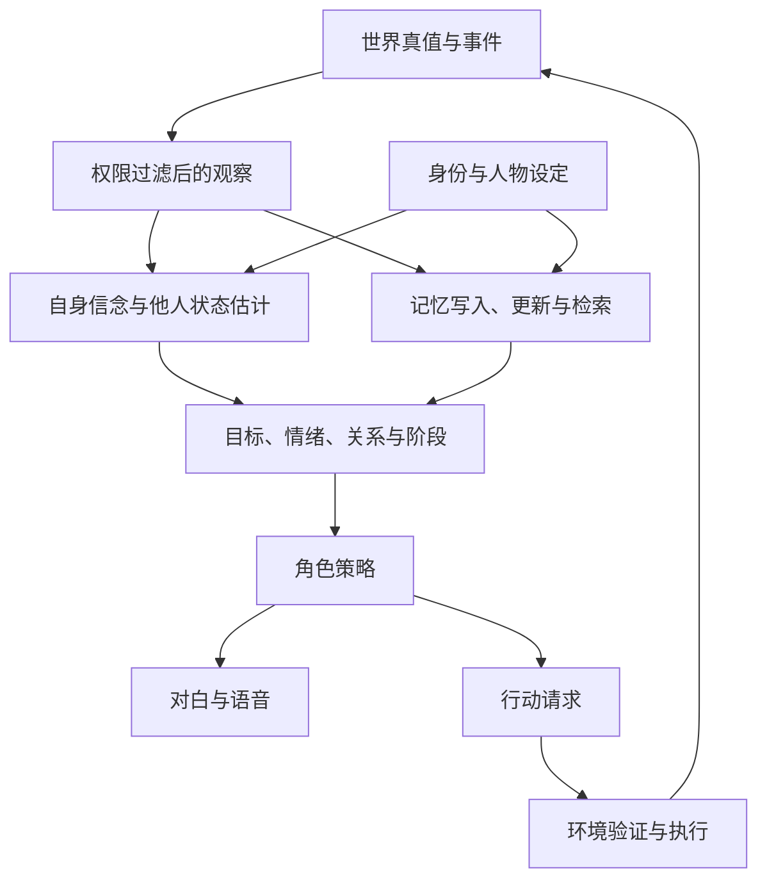

# Role-Playing 与 Game NPC Agents：研究领域地图

> **文献与资源核查截至：2026-10-29（UTC）。** 本文中的 roadmap 指研究问题、方法、数据、评价和证据之间的地图，不是选题推荐、项目排期或技术路线优先级。重点覆盖 2025—2026 年正式论文，同时保留理解研究演变所必需的经典工作，并单独标明预印本、workshop 和工业材料。

## 文档导航

- [1. 研究对象与边界](#scope)
- [2. 综述如何划分这个领域](#surveys)
- [3. 统一分析框架：人物、状态、观察、记忆与行动](#framework)
- [4. 角色数据与人物构建](#data)
- [5. 人设约束、知识边界与心智理论](#epistemic)
- [6. 人格、情绪、动机与可解释决策](#psychology)
- [7. 角色推理、偏好优化与强化学习](#training)
- [8. 记忆、角色成长与关系演化](#memory)
- [9. 多角色共享与连续人格控制](#scaling)
- [10. 多智能体社会交互](#social)
- [11. 可执行行动、游戏世界与互动叙事](#games)
- [12. 视觉、视频、语音与具身角色](#multimodal)
- [13. 实时运行与系统代价](#runtime)
- [14. 评测体系、数据集与 baseline 的可比性](#evaluation)
- [15. 角色价值、安全与用户交互边界](#safety)
- [16. 当前证据覆盖与尚未覆盖的区域](#evidence)
- [17. 对常见概括的校正](#corrections)
- [18. 文献、资源与阅读审计](#audit)

配套文件：[完整文献与阅读层级索引](docs/LITERATURE.md) · [数据、环境、代码与权重资源地图](docs/RESOURCE_ATLAS.md)。正文承担概念和研究脉络的解释；配套文件保留完整题录、版本、资源入口和发布状态，避免把论文名罗列当成综述。

### 这份地图的基本判断

这个领域研究的对象已经超出“用某个角色的口气回答问题”。它同时涉及：人物设定如何成为可执行的行为条件；人物此时能够知道什么；人物怎样理解自己和他人的动机；记忆如何保留事实又表达主观解释；关系与心理状态怎样随事件变化；多个角色如何协商、隐瞒和协作；语言输出如何落到真实游戏状态；以及以上能力怎样被可靠测量。

这些问题没有汇合成一个统一的“角色扮演能力分数”。一个系统可以在心理访谈中很像人物，却泄露人物不应知道的剧情；可以准确回忆玩家的承诺，却无法在引擎中完成承诺；可以保持静态设定，却无法表现有因果依据的成长。理解论文时，**任务对象、信息条件、交互协议、评价者、数据划分和资源可用性**，与模型名字和排行榜分数同样重要。后文将逐条说明这些差别。

## 1. 研究对象与边界

### 1.1 相邻概念不能混用

| 对象 | 核心问题 | 与本领域的关系 |
| --- | --- | --- |
| Role-playing language model / agent | 在特定身份、经历、价值和处境下生成可信的言语与行为 | 本文核心；既包括已知作品人物，也包括原创人物 |
| Game NPC agent | 持续处于游戏世界、具有权限和状态、能与玩家及其他实体交互 | 除角色可信度，还必须考虑行动合法性、世界状态、时序和系统成本 |
| Persona-conditioned assistant | 以身份或风格条件完成一般任务 | 与角色控制相交，但“扮演专家”不自动构成持续人物模拟 |
| Personalized assistant / companion | 依据用户偏好和历史适应用户 | 可以与角色扮演共存，但对齐用户偏好与保持自身角色是不同目标 |
| User simulator / social simulator | 模拟用户、群体或制度中的行为 | 可复用角色技术；逼真不等于已验证的人类行为模型 |
| Game-playing agent / VLA | 感知画面、规划并操作游戏以完成目标 | 可成为 NPC 的执行层；会玩 RPG 不等于会扮演 RPG 中的人物 |
| Director / game master / narrative agent | 调度场景、角色和事件，维持故事结构与规则 | 是管理叙事的另一类主体，知识权限通常不同于演员 NPC |

“角色扮演”和“个性化”的区别在 [Two Tales of Persona](https://aclanthology.org/2024.findings-emnlp.969/) 中被明确提出：前者主要条件化模型所扮演的身份，后者主要条件化服务对象的身份与偏好。[From Persona to Personalization](https://arxiv.org/abs/2404.18231) 则覆盖更宽的角色、人群属性与个体化模拟。两种视角互补，但不能把推荐系统或所有用户建模工作直接计为游戏 NPC 的成果。

### 1.2 “角色”本身也有不同的监督来源

**已有作品人物**有小说、剧本、对白、人物关系和事件作为依据。其优势是可追溯；困难是原作只给出有限处境，角色可能成长、撒谎或自相矛盾，预训练又可能已记住结局。

**原创人物**通常只有 profile、背景和世界规则。其优势是可控、较少依赖知名 IP；困难是“正确反应”不存在唯一原作答案，评价者容易把自己的常识和道德偏好当成人设真值。

**真实人物或人群模拟**另有外部效度问题：模型像某类人的刻板印象，不等于能预测该群体的实际行为。**游戏内临时身份**还可能由职业、阵营、任务阶段和当前目标组合而成。以上对象在训练覆盖、知识泄漏、评价参考和角色泛化上有不同困难，不能只按“角色数量”比较数据规模。[RoleLLM](https://aclanthology.org/2024.findings-acl.878/) 的已知角色、[OpenCharacter](https://arxiv.org/abs/2501.15427) 的合成人物、[CoSER](https://proceedings.mlr.press/v267/wang25dk.html) 的文学人物场景正体现了这些差别。

### 1.3 本文如何取舍文献

纳入的工作需要直接研究人物条件、角色行为、角色评价或 NPC 交互，或者明确提供相关的记忆、社会环境和执行机制。会议名称是核验发表状态的依据，不是方法正确性的证明；强团队的预印本也仍按预印本对待。检索覆盖 ACL 系列、AAAI、ICLR、ICML、NeurIPS、CVF 会议及相关 HCI/多媒体研究，但不以每个会议必须凑足篇数为目标。仅把 role-play 当作通用提示词的数据合成工作，或只研究角色扮演游戏中的战斗控制，不据标题纳入角色忠实度的核心证据。

## 2. 综述如何划分这个领域

### 2.1 七份综述提供的不同坐标系

| 综述与正式状态 | 主要组织方式 | 对理解领域的作用与边界 |
| --- | --- | --- |
| [Two Tales of Persona in LLMs](https://arxiv.org/abs/2406.01171)，EMNLP 2024 Findings | Role-playing 与 personalization；模型中的 persona 和用户的 persona | 适合解释研究对象与对齐目标；不能把两个分支的结果直接相加 |
| [The Oscars of AI Theater](https://arxiv.org/abs/2407.11484)，2024 预印本，阅读 2025 年更新版 | 数据构造、角色模型、agent 系统、评价 | 将作品抽取、训练和运行时系统接起来；“角色扮演都是对话”等概括并不覆盖有执行器的 NPC |
| [From Persona to Personalization](https://arxiv.org/abs/2404.18231)，TMLR 2024 | 人群属性、既有角色、个体化人物，以及应用、方法和评价 | 范围较广，显示已知 IP 不是唯一对象；几个 persona 类型可以并存，不是技术代际 |
| [Towards a Design Guideline for RPA Evaluation](https://aclanthology.org/2025.findings-acl.938/)，ACL 2025 Findings | 六类 agent 属性、七类任务属性、七类评价指标 | 将评价与任务设计关联；系统检索得到 1,676 条记录，最终全文纳入 122 篇，不能说精读分析了 1,676 篇 |
| [Role-Playing Agents Driven by Large Language Models: Current Status, Challenges, and Future Trends](https://arxiv.org/abs/2601.10122)，2026 预印本 | 技术演变、架构、应用与挑战 | 提供宏观组织；本文对它作定点核读，方法与实验细节仍回到原论文 |
| [More Than a Role: Memory in LLM-based Role-Playing Agents](https://github.com/aixiaodewugege/More-Than-a-Role-Memory-in-LLM-based-Role-Playing-Agents)，KDD 2026 PILA Workshop Oral，非 archival | Character-side 与 interaction-side memory，两流的写入、组织、检索、更新和融合 | 将角色稳定与关系变化放在同一个记忆框架；不是 KDD 主会论文，workshop 状态以[官方日程](https://pila26-workshop.github.io/)为准 |
| [Role Consistency in Role-Playing Agents](https://aclanthology.org/2026.findings-emnlp.625/)，EMNLP 2026 Findings | 评价、记忆、推理、对齐和安全的一致性问题 | 把一致性放在完整生命周期中；“一致性”仍须细分为事实、时间、心理和关系等不同对象 |

几份综述的价值在于分类与串联，不能替代原论文核验。例如，记忆综述对个别早期模型的训练方式和 InCharacter 的访谈流程存在简化；宏观综述偶尔把心理活动文本称为多模态。本文涉及具体方法、样本量、评价协议与发布状态时，使用原论文和作者资源，而不是沿用二手概括。

### 2.2 研究演变是多条并行线

早期人格对话和游戏对话研究已经涉及人物背景、环境和动作。[LIGHT](https://aclanthology.org/D19-1062/) 把幻想世界中的对话、表情和行动放入同一环境。[Character-LLM](https://aclanthology.org/2023.emnlp-main.814/) 在 2023 年就通过经历、思考和保护性体验构造角色训练；[Generative Agents](https://arxiv.org/abs/2304.03442) 同期研究记忆、反思和计划。因此，将 2023—2024 年一概称为“只模仿口吻”，再把 2025 年后的全部研究称为“首次获得心智”，不符合原论文。

更准确的演变是以下几条线不断深化：

| 研究线 | 早期关注 | 2025—2026 年进一步区分的问题 |
| --- | --- | --- |
| 人物条件 | 名字、profile、典型台词 | profile 的结构和信息密度、原创角色、价值冲突、场景中的角色逻辑 |
| 行为监督 | 对白模仿、知识问答 | 人格指示情境、隐含动机、私有目标、思考与行动的关系 |
| 时间与记忆 | 历史拼接、相似度召回、反思 | 观察权限、事件时间线、主观解释、角色弧线、必要记忆的使用 |
| 训练反馈 | SFT、整体偏好 | 可追溯约束、比较奖励、hint、角色条件归一化、多目标和长短期奖励 |
| 交互单位 | 单次回答、固定历史续写 | 双人目标博弈、多方私有通道、闭环轨迹、场景调度 |
| 输出接口 | 文字对白 | 声音身份、语音表演、图像和视频理解、工具调用、引擎动作 |
| 证据标准 | 整体像不像、词面相似 | 分能力诊断、原作时间点、因果对照、人工校准、成本和发布完整性 |

这张表是对后文文献的综合组织，不是各阶段互相替代的历史定律。SFT、检索、手工状态、神经模型和游戏规则仍共同存在。

## 3. 统一分析框架：人物、状态、观察、记忆与行动

### 3.1 一个角色至少包含哪些不同状态

以下是本文用于比较方法的分析模型，不是某篇论文已经验证的统一 NPC 架构。对角色 $i$，可以区分：

- $I_i$：身份、背景、稳定倾向与原始设定。
- $W_t$：世界在时刻 $t$ 的真实状态，包括位置、物品、任务和事件。
- $o_t^i=\Omega(W_t,i)$：该角色实际能观察到或被告知的内容。
- $b_t^i$：角色对世界的信念；允许不完整、过时或错误。
- $\hat b_t^{i\to j}$：角色对另一个主体 $j$ 的信念、目标或知识的估计。
- $m_t^i$：可持久化的经历、事实、推断、关系记录和检索索引。
- $d_t^i$：当前目标、情绪、关系、承诺和叙事阶段等动态状态。
- $(u_t^i,a_t^i)$：角色说出的内容与提交给世界的行动。

可写成一个条件策略：

$$
(u_t^i,a_t^i)\sim\pi_i(\cdot\mid I_i,o_{\le t}^i,b_t^i,\hat b_t^{i\to *},m_t^i,d_t^i).
$$

行动只有经过环境规则才产生状态转移：$W_{t+1}=\mathcal T(W_t,a_t^1,\ldots,a_t^n)$。在纯文字 benchmark 中，$\mathcal T$ 可能不存在、由评审想象，或由另一个 LLM 叙述；在游戏引擎中，它可以是独立、可检查的规则。两者的“行动成功”证据强度不同。

### 3.2 五个经常被混为一谈的“正确”

| 判定对象 | 例子 | 所需证据 |
| --- | --- | --- |
| 世界事实正确 | 钥匙实际上放在柜子里 | 世界状态或原作证据 |
| 知识权限正确 | 角色没有看见换位置，也没人告诉他 | 观察、通信和时间记录 |
| 信念表现正确 | 角色仍以为钥匙在桌上 | 对其历史与信念的可追溯解释 |
| 价值和行为可信 | 多疑角色是否相信玩家提供的线索 | 人物条件、情境和合理行为范围 |
| 行动执行正确 | 角色确实走到桌前并尝试寻找 | 引擎轨迹、合法动作和实际状态变化 |

一个说出世界真相的角色，可能同时违反知识权限；一个说错位置的角色，可能忠实地表现了错误信念。一个人物可以隐瞒自己知道的事实，也可以真诚地说出错误信息。因此，普通问答的“准确率”和角色扮演的“忠实度”不能直接互换。[TimeChara](https://aclanthology.org/2024.findings-acl.197/)、[The Curse of Knowledge in Role-Playing Language Models](https://arxiv.org/abs/2610.17327) 和后文的多方隐私环境分别从时间、信息访问和社会决策检验这个问题。

### 3.3 论文的实验单位决定结论范围

本文始终区分六种协议：单轮访谈；给定历史后的下一句；由测试 agent 动态追问的多轮对话；从初始条件重新滚动的闭环轨迹；固定原作时间线上的下一动作预测；有独立环境规则的可执行交互。历史里有 800 轮，不代表被测模型自己成功运行了 800 轮；有动作描写，不代表调用了执行器；有多个角色的训练文本，也不代表进行了多智能体强化学习。这一协议区分贯穿后文所有方法和资源比较。

## 4. 角色数据与人物构建

### 4.1 数据不是单一的“角色对话”

角色数据至少有五种不同的信息：**人物事实**回答他是谁；**人物语言**体现他说话的方式；**情境—选择**体现处于某处境会怎么做；**人物私有信息**体现他知道什么、想要什么；**事件与后果**体现行为怎样改变世界和关系。只增加对白数量，未必增加后面三类监督。[RolePersonality](https://aclanthology.org/2024.findings-emnlp.853/) 的等数据量比较、[CoSER](https://proceedings.mlr.press/v267/wang25dk.html) 的场景化数据和 [Beyond Dialogue](https://aclanthology.org/2025.acl-long.586/) 的 profile—dialogue 对齐分别研究了这种信息差。

### 4.2 从一人一模型到条件化、多角色和原创人物

**Character-LLM：让训练样本具有经历。** 它围绕九个人物重建经历，包括心理活动、情绪和互动，并构造保护性经历，为人物训练各自的模型。其意义不只是收集台词，而是让背景、事件和情绪进入监督。不过，生成经历仍受教师模型和角色材料约束，人物独立模型也不直接解决大规模多角色共享。[原文](https://aclanthology.org/2023.emnlp-main.814/)

**RoleLLM / RoleBench：角色条件下的通用指令与角色特定问题。** RoleBench 包含 100 个角色，其中 95 个英文、5 个中文；角色构建、上下文中的角色知识和说话风格共同形成训练数据。论文区分对未见指令与未见角色的泛化。它为大量后续工作的 SFT 和评价提供基础，但其数据进入后来模型训练后，就不能继续默认是独立的未知测试集。正式发表是 **ACL 2024 Findings**。[原文](https://aclanthology.org/2024.findings-acl.878/)

**DITTO：从底座自身生成角色对齐样本。** 论文借“LLM 包含许多角色的叠加”描述预训练知识可以被条件化唤起；这是建模比喻。方法通过角色知识和对话模拟生成角色相关与角色对比内容，减少依赖外部强教师的逐条蒸馏。它研究怎样激活和约束底座已有的角色能力，不是证明参数里存在可物理分离的完整人物，也不是对所有超出角色知识的问题提供硬隔离。[原文](https://aclanthology.org/2024.acl-long.423/)

**OpenCharacter：把数据对象从已知 IP 扩到可定制人物。** 该预印本用大规模合成 persona 构造约两万原创角色，检验模型对未见人物描述的适应。它缓解作品人物覆盖不足，但生成角色的多样性取决于合成器；在 PersonaGym 上与某一闭源模型接近，并不等于在原作忠实度、长程互动、行动或安全上全面接近。[原文](https://arxiv.org/abs/2501.15427)

### 4.3 人格指示数据：为什么有些台词不能代表性格

RolePersonality 沿用 InCharacter 改写的 **14 类量表访谈**，让带 profile 与角色记忆的教师生成回答，再按已有角色标签筛选。量表覆盖人格、依恋、兴趣、自我效能、金钱态度、情绪能力等，并非 14 种等价的“人格真值”。在同一 Mistral-7B、约 20K 样本和相同 LoRA 设置下，RoleBench 或 Character-LLM 数据微调可能降低特定人格指标，RolePersonality 则改善人格维度与动机选择题表现。这支持“语料中的心理倾向覆盖很重要”，但没有证明对白 SFT 普遍损害人格，也没有把量表表现验证为真实内在心智。训练和评价共享心理框架，测试仍主要依赖模型与既有标签。[原文及正式数据入口](https://aclanthology.org/2024.findings-emnlp.853/)

### 4.4 场景、关系、内心活动与动作共同构成监督

**CoSER 的关键单位是规定情境中的人物。** 数据来自 771 本书，包含 17,966 个角色和 29,798 段对话，提供背景、人物关系、目标、心理活动、动作与话语。其 Given-Circumstance Acting 评价在共享处境下模拟互动，考察不只“像不像一句经典台词”，还包括情境相关反应。训练实现按“目标角色—对话”组织样本，对目标角色输出计算损失；并不是一个训练样本让模型轮流对所有角色输出都计算 actor loss。心理活动与部分结构化描述经过教师抽取或推断，也不能全部当作原作中直接可见的心理事实。[ICML 2025 原文](https://proceedings.mlr.press/v267/wang25dk.html)

**Beyond Dialogue / CSERP 关注 profile 与对白的语义对齐。** 角色、风格、情绪、关系和人格等维度共同参与数据构建与检查。对于没有明确表达全部设定的对白，核心是发现与修复不一致，不应把“该句没体现某设定”一律当成冲突；人物可能在当前情境中没有理由展示每个特征。该工作提供了比仅用人名提示更结构化的监督对象。[ACL 2025 原文](https://aclanthology.org/2025.acl-long.586/)

**RoleAgent 研究从剧本自动建立可查询的角色。** 它把原始文本组织为观察、事件、关键点和洞察，并在交互中提取自身、对方及关系相关记忆。128 个角色、25 部中英文剧本构成其评价池。知识判断、反应和总结等评价说明了自动角色构建的可用性；这些测试主要是离线角色探针，不是一个自动运行的完整社会。[NeurIPS 2024 Datasets & Benchmarks 原文](https://papers.nips.cc/paper_files/paper/2024/hash/5875aca1ef70285a35940afbbce0f9fb-Abstract-Datasets_and_Benchmarks_Track.html)

### 4.5 Profile 本身成为可研究变量

**ProfileAxes / FACD** 控制已知与合成人物、结构化与非结构化描述，以及不同属性组合，在丰富、信息匹配的 profile 条件下比较模型。这里“名字是否熟悉”和“表格是否整齐”的影响比某些先验想象小，价值属性与模型原有对齐之间的冲突更显著。但结论有明确条件：它不等于简短 profile 与详细 profile 等价，也不等于预训练熟悉度在所有任务中无效。[EMNLP 2026 原文](https://aclanthology.org/2026.emnlp-main.1590/)

**FURINA** 则把人物放进陌生故事情境，用公开/私有人物信息、actor/director 构造和多维选择过程来测试更广的处境。它发现已知与原创人物、能力和幻觉之间的不同表现，但主要评价给定历史后的单个目标发言，不能写成已完成长程群体自由互动评测。其结果与 ProfileAxes 不必矛盾：人物覆盖、描述密度、场景分布和评价信息条件不同。截至核查日期，FURINA 按 **arXiv 预印本**记录，不能补写未经确认的 ICLR 录用。[2026 年更新版](https://arxiv.org/abs/2510.06800)

### 4.6 数据质量的实质问题

这个分支的核心不仅是“有没有更多训练样本”，还包括样本中的人物事实是否可追溯、台词受情境而非人格支配的程度、内心活动是原文还是教师推断、私有信息有没有意外放入公共上下文、原创角色是否只是模板替换，以及训练和评价是否共享作品、人物或教师。文学材料还有分发许可：论文能处理的原始书籍，不一定能完整公开。后文资源地图因此分别记录论文规模、公开子集和实际可下载文件。

## 5. 人设约束、知识边界与心智理论

### 5.1 人设忠实度：相关设定要体现，无关设定也不能违背

[APC：Quantifying and Optimizing Global Faithfulness](https://proceedings.neurips.cc/paper_files/paper/2024/hash/309cadc33589efca4018a490c07db263-Abstract-Conference.html) 将 persona 拆成原子陈述，区分当前问题的 **active constraints** 与 **passive constraints**。例如，问题问一个角色的职业，职业信息需要体现；角色不喝酒这一事实虽不必主动提及，也不应被顺带违背。它把“召回了相关资料”与“没有冲撞其他资料”区分开来。

若 $g_i$ 表示陈述 $s_i$ 与问题相关的概率，$e_i$、$c_i$ 表示回答对该陈述的蕴含、矛盾概率，论文的软评分可以写为：

$$
V_{\mathrm{APC}}=\sum_i[g_ie_i+(1-g_i)(1-c_i)].
$$

扣除中性回复天然获得的被动约束分数后，有：

$$
\Delta V_{\mathrm{APC}}=\sum_i[g_ie_i-(1-g_i)c_i].
$$

这个形式提供逐项诊断：某条必要信息没有体现，或某条背景设定被违背。**它是由相关性与 NLI 模型估计的期望满足数量，不是所有设定必然成立的证明。** 公开实现按总 APC 分数筛选 chosen/rejected，再调用 DPO；论文中的逐项加权表达、公开训练操作和全局一致性保证是三件不同的事。平均分改善中仍有角色退化。其原实验主要是单轮 profile 忠实度，也不自动覆盖动态设定、说谎、秘密和观察权限。[论文与代码](https://github.com/KomeijiForce/Active_Passive_Constraint_Koishiday_2024)

### 5.2 时代、剧情时间与亲历范围是不同边界

**时代边界**限制人物不应掌握的概念；**剧情时间边界**限制未来事件；**观察边界**限制此时谁看见了什么；**通信边界**允许角色通过他人报告获得未亲历的信息。这些限制都不是一句“只能使用角色知识”就能完全明确的。

[TimeChara](https://aclanthology.org/2024.findings-acl.197/) 把人物放在具体剧情时间点，提供 10,895 个问题，主要实验使用其子集，区分未来事件、过去不在场、过去在场等条件。Narrative-Experts 先判断问题与人物时间和经历的关系，再生成回答。其贡献是把“某人物知道某事实”细化为“某人物在此节点应知道什么”。不过，不在场并不逻辑上等于不可能听说；原作知识标签仍依赖对事件和人物经历的整理，不能把 absence 规则当成所有游戏的通用访问控制。

[DREAM](https://arxiv.org/abs/2608.05170) 在 KDD 2026 的工作中用事件记忆图与动态人物描述整合时间和推断的因果关系，处理静态 profile 无法表达剧情阶段的问题。这里的“动态”主要指完整小说中随时间变化的角色信息，并不是已验证的持续玩家交互写入机制；其部分评价是 LLM 偏好胜率，也不是独立的时间知识真值准确率。

### 5.3 看懂权限描述，不等于生成时遵守权限

2026 年预印本 [The Curse of Knowledge in Role-Playing Language Models](https://arxiv.org/abs/2610.17327) 使用成对反事实场景：角色看不到的信息发生变化，观察到的信息保持可比。如果输出仍跟随隐藏事实变化，就有比普通错误率更直接的泄漏证据。翻译或状态理解探针又区分“没读懂谁能看到”与“知道权限但行为仍泄漏”。

这条研究线的关键发现是：**描述性理解与行为约束可以分离**。某些模型能回答“角色没有看到”，下一句却说出隐藏位置。提示布局、人物描述和推理模式会改变结果，较大闭源模型在基本条件下也并非普遍失败。实验中的声音、视线和私信都是文本状态描述，不是实际音视频感知测试。引擎产生的角色可见视图在该实验中有效，但前提是访问元数据正确；既不能删除本来可观察的事件外壳，也不能靠检索过滤消除底座已经记住的剧情。

### 5.4 从知识过滤到以角色视角组织记忆

[REVERIEMEM：Staying in Character](https://arxiv.org/abs/2606.25632) 将第一人称经历、可见事实结构与角色表达结合，并提出 KBF-QA 检验该回答还是该拒绝。这比直接把整本小说作为检索库更明确地区分全局文本和人物视角。其约 4.4K 问题来自八本书，知识权限由构建过程标定；若记忆构建和评价共用同一可见性假设，评价上的一致可能部分来自标签机制。当前未核到可完整下载的数据和实现，不能只因方法图完整就当作已有现成 baseline。

从 APC、TimeChara 到视角记忆，可以看出三类约束并不相互替代：APC 检查 **回答是否体现相关设定、是否违背其他设定**；TimeChara 检查 **人物—时间—事件关系**；视角记忆检验 **可进入角色上下文的证据范围**。一个系统可能需要同时处理三类问题，但论文通常只控制其中一部分。

### 5.5 心智理论研究中有三个不同被测对象

第一类是**观察者推断**：给定对话，判断角色相信、想要或感受到什么。第二类是**角色行为**：把模型置于某个角色，它是否依据自己的错误信念行动。第三类是**递归社会推断**：角色需要估计别人知道什么、别人怎样看自己，并据此披露、询问或隐瞒信息。心理活动文本可为第一类提供合成标签，但不是独立观察到的真实心理状态；推断题答对也不保证第二、三类行为稳定。

[ToMATO，AAAI 2025](https://ojs.aaai.org/index.php/AAAI/article/view/32143) 是第一类的具体实例：让角色在信息不对称下生成私有 thoughts 和公开发言，再构造信念、意图、欲望、情绪与知识的一阶、二阶选择题。实际公开数据为 753 段对话、5,401 题，其中 806 道二阶 false-belief 题已包含在总数中。被测模型是阅读完整对话的观察者；对话还可能包含被问时点之后的发言。因此它测试可记录的合成心理文本能否被推断，不是在测被扮演 NPC 当场如何行动，也不是测真实人的心理。数据与参考代码实际公开，但有用途限制和接口需核对，不能把“公开”改写成已跑通。

这些区别连接了基于时间点的知识问答、角色推理训练和 [SOTOPIA-TOM](https://arxiv.org/abs/2605.02307) 的多方信息管理。后者使用环境强制的公共/私有通道与共享规则，让知识和披露产生交互后果；它仍主要属于专业合作场景，不能仅因包含 ToM 就外推到文学人物的情感深度。

## 6. 人格、情绪、动机与可解释决策

### 6.1 人格一致不等于问卷答得“像”，也不等于每次作同一种选择

[InCharacter](https://aclanthology.org/2024.acl-long.102/) 通过开放式心理访谈，再将回答映射到量表维度，减少直接选择题暴露量表意图的问题。其 32 个角色、14 类量表为人格研究提供了细粒度工具。但角色标签来自对人物的解释和既有社区资料，并非临床人格真值；访谈上下文的隔离也意味着它主要测条件化回答，不能单独证明跨月稳定性。论文中的维度准确率与整个人格类型匹配率不同，不能用前者替代后者。

人格研究还面临**表现条件依赖**：谨慎的人物可以在拯救朋友时冒险，慷慨的人物可以对欺骗者拒绝帮助。仅检查固定形容词可能把有理由的变化判成 OOC。RolePersonality 通过人格指示问答监督改善动机识别；CoSER 通过规定情境限制行为解释；后文 ArcANE 则把人物所处阶段纳入评价。它们把研究对象从“恒定标签”向“有条件的行为规律”推进，但并未形成统一的人类心理模型。

### 6.2 情绪是状态变量，不能只靠形容词拼接

[MECoT](https://aclanthology.org/2025.findings-acl.435/) 显式维护情绪转移：12 个离散情绪位于效价—唤醒度二维空间，以距离形成基础转移，再由人物倾向与当前语境调整。模型可以按期望、最大值或采样选择下一状态，再生成对应角色表达。其贡献是把“现在是什么情绪、为什么转变、怎样说出来”分开，而非让每轮回复重新随机决定情绪。

这类工作显示了显式状态建模的可解释性，也暴露出验证问题：转移概率、人格映射和状态标签很大程度由设计者或语言模型给出；在 RAPD、DailyDialog 上的情绪分类一致与模型评分，不等于验证真实人的情感动力学。MECoT 的状态更新也不是仅因用了 reward 一词就成为标准策略梯度 RL。

### 6.3 从人物描述编译出行为条件

[Codifying Character Logic](https://papers.neurips.cc/paper_files/paper/2025/hash/15294ba2dcfb4521274f7aa1c26f4dd4-Abstract-Conference.html) 将自然语言人物描述离线转成带条件分支的代码。运行时根据场景判断条件，取出当前适用的角色陈述，交给生成模型。强模型承担编译，较小模型执行；条件判断还可蒸馏给小型分类器。它把长篇人物描述转为“何种处境触发何种反应”的结构，是人物逻辑显式化的一条路线。

但其条件判断仍含语义模型，不是纯逻辑公理；代码的可执行性也不等于人物行为已被形式验证。主要 Fandom 评价是对原作场景预测下一动作，以 NLI 与参考动作比较。论文的 evolving 设置会在场景后提供参考动作来修改代码，不能描述成无监督地在开放游戏中自行学会人物成长；Best@K 也需要从多个结果中利用参考挑选，并非单次交互体验。

[Codified Decision Tree（CDT）](https://aclanthology.org/2026.acl-long.568/) 进一步从场景—动作样本中聚类、提出 if–then 规则，并用 NLI 验证规则对节点样本的覆盖，再递归组织成决策树。推理时可以沿多个成立分支收集行为依据。它将人物行为知识从手写 profile 扩到数据归纳，在 Fandom 与 Bandori 的动作序列上比较 SFT、检索示例和文本/代码 profile。树仍是离线构建，时间切分也不消除底座对知名原作的预训练记忆；与原作单一动作相似，不等于在多个合理选择中作出了唯一正确决定。

### 6.4 角色的价值偏好与模型的默认偏好

一个善良、愤世嫉俗、自私或守规矩的人物，应在适当情境中表现不同判断。通用助手的礼貌、合作和道德化倾向可能压平这些差别。[ProfileAxes / FACD](https://aclanthology.org/2026.emnlp-main.1590/) 用属性对照和同模型家族训练阶段分析这一现象，并用完整 profile 与移除特定属性的 profile 形成对比分布，强化被压制的角色条件。

这里有两条独立坐标：**是否忠实表现虚构价值**，以及**是否输出现实有害指导**。一个反派可以在故事中威胁、嫉妒和操纵剧情，却不需要提供现实伤害操作细节；一个总是劝人向善的模型也未必演好了反派。FACD 在其安全评测中的低违规率支持特定条件下的兼容性，不能扩大为对所有攻击和长期互动的保证。第 15 节进一步讨论这种区分。

### 6.5 关系、承诺和成长具有不同时间尺度

情绪可在一轮内改变；信任可能积累若干事件才发生变化；身份和核心价值通常更稳定，但也会在角色弧线中改变。把这些变量全部写成一个“好感度”会丢失关系的非对称性：A 信任 B，并不推出 B 信任 A；愿意合作、喜欢对方、害怕对方和相信对方说的话也可以分离。RoleAgent 的关系记忆、CoSER 的私有目标、REMP 的关系与情绪探针，以及 ArcANE 的阶段评价分别触及其中一部分。现有工作已经提供具体表示和测试，但尚没有一个被广泛验证的统一关系状态空间。[RoleAgent](https://papers.nips.cc/paper_files/paper/2024/hash/5875aca1ef70285a35940afbbce0f9fb-Abstract-Datasets_and_Benchmarks_Track.html) · [REMP](https://aclanthology.org/2026.findings-emnlp.602/) · [ArcANE](https://aclanthology.org/2026.emnlp-main.1998/)

## 7. 角色推理、偏好优化与强化学习

### 7.1 推理的内容和视角，比是否显示长 CoT 更具体

一般推理模型会分析“怎样作为助手完成扮演任务”，这与人物自身如何感受、打算和行动不同。角色推理研究尝试调整中间表示，使其服务于人物处境。这里的 thought 是训练或生成出的文本，不是可以直接观察的真实内在心理；论文应通过它对行为的影响来验证，而不能凭第一人称独白就宣布有了心智。

| 工作 | 改变的对象 | 机制与可支持的结论 |
| --- | --- | --- |
| [R-CHAR，EMNLP 2025](https://aclanthology.org/2025.emnlp-main.1372/) | 思考训练数据 | 搜索、反馈和修订构造角色思考，再做 SFT；“metacognition”不等于在线强化学习 |
| [Thinking in Character / RAR，NeurIPS 2025](https://papers.nips.cc/paper_files/paper/2025/hash/aacca7b6a20d157112205a44f42821c8-Abstract-Conference.html) | 身份激活与推理风格 | 将角色身份相关训练与适合角色任务的思考方式分开；更多通用 thinking 并非自然更好 |
| [HER，ACL 2026 Findings](https://aclanthology.org/2026.findings-acl.1283/) | 系统规划与人物独白 | 私有系统思考处理整体要求，第一人称角色思考组织情绪与潜台词，再用生成式奖励优化 |
| [Character-R1，2026 预印本](https://arxiv.org/abs/2601.04611) | 结构化认知焦点 | 显式选择角色认知维度，以焦点标签、属性与参考重叠构造反馈，做角色条件化 GRPO |
| [VeriRole，ICLR 2026](https://proceedings.iclr.cc/paper_files/paper/2026/hash/12df08e9280061b4877f97598c644c3e-Abstract-Conference.html) | 回答前的可追溯 hint | 从人物、历史与语境提取提示，围绕来源、关键词、语义与角色表现建立奖励 |

**HER 的两个层次不能与其评价设置分开理解。** 其系统思考不直接作为角色话语，角色第一人称思考则是生成输出的一部分，相关评审会看到它。原版 CoSER 的评价对内心活动的处理不同，HER 又使用不同的 judge，因此不能把两篇的 CoSER 总分拼成统一榜单。HER 的增益也主要包含底座到角色 SFT 的大幅变化；在该论文的消融中，从 SFT 再到 RL 的改善较小，不能将总改善全部归功于 RL。[HER 原文](https://aclanthology.org/2026.findings-acl.1283/)

### 7.2 “可计算奖励”“可验证线索”和“客观人格真值”不同

角色任务允许多种合理回答，常常没有像算术答案那样唯一、独立的检查器。2025—2026 年论文所用反馈可分为：

| 奖励来源 | 典型形式 | 它实际验证的对象 |
| --- | --- | --- |
| 程序规则 | 格式、长度、重复、合法 action schema | 规则是否满足；通常不直接验证角色深度 |
| 资料条件下的规则或匹配 | focus 标签、hint 来源、关键词、参考重叠 | 与给定结构和参考的对应程度；合理新表达可能被漏计 |
| 语义判别器 | NLI、人物约束判定、情绪分类 | 判别模型估计的语义关系，存在标注与迁移误差 |
| 偏好或生成式奖励模型 | 成对优劣、按语境生成评分原则 | 训练标注者或评审的偏好近似 |
| 交互结果 | 任务达成、信息泄漏、物品转移、规则冲突 | 若由独立环境记录，具有更明确的行为结果含义；社会“达成”仍可能由 LLM 判断 |

Character-R1 用少量样本得到改善，说明结构化反馈有利用价值；VeriRole 的 hint 则让评价更容易追溯。两者都不能被概括成“开放式角色扮演已拥有完全可验证奖励”。VeriRole 也保留模型评分成分；BLEU/ROUGE 或关键词可确定计算，并不使其代表的人物质量变得客观唯一。[Character-R1](https://arxiv.org/abs/2601.04611) · [VeriRole](https://proceedings.iclr.cc/paper_files/paper/2026/hash/12df08e9280061b4877f97598c644c3e-Abstract-Conference.html)

### 7.3 主观奖励：比较、分歧与语境化标准

**CPO** 把同一语境中的候选回复放在一起比较，减少孤立绝对分数的含义漂移。它研究的是相对质量和 reward ambiguity，改善仍依赖候选池、标注尺度与评价器。[EMNLP 2025 Findings](https://aclanthology.org/2025.findings-emnlp.18/)

**AAM（早期版本名 ChARM）** 用模型生成似然比的差异估计偏好 margin，对不同样本动态校准比较，并加入 SFT 正则。它试图适应角色偏好的主观模糊性，而非给所有偏好对使用同样的分离强度；并没有显式学习每个标注者独立的偏好分布。其人物和对话数据为奖励研究提供资源，但作者仓库中的数据公开程度与训练实现、模型权重公开程度不同；旧版和改名后的正式论文也不能计作两个独立突破。[ACL 2026 Main](https://aclanthology.org/2026.acl-long.710/)

**HER-RM** 针对语境生成评分原则，试图避免所有人物都用一套空泛标准打分。原则生成使反馈更细，但也多了一层评审模型的不确定性：原则是否忠实于人物，是否偏爱更长的内心独白，以及训练后策略是否学会迎合其表达。人类校准能提供证据，但不能使奖励模型自动成为真值。[HER](https://aclanthology.org/2026.findings-acl.1283/)

### 7.4 多目标优化：角色表现不是一个均质奖励

**MOA** 将对话质量、角色知识和风格等目标分开，依据训练趋势调整权重，并处理不同目标对候选排序的冲突。它的实验中，朴素 GRPO 可以比 SFT 更差，而加入思考、教师数据和多目标机制后改善；因此不能将所有提升归给单一“用了 RL”。[ACL 2026 Main](https://aclanthology.org/2026.acl-long.531/)

**CRPO** 区分同一 prompt 内的任务优势与角色层面的风格优势，以角色相关统计、归一化和约束控制更新。它解决的是不同角色和目标的 reward 分布不均衡，而不是定义一种普适的人格标尺。比较时也要保留其底座、训练样本和 SocialBench 协议；在同一表内领先 Character-R1，不等于所有角色、长对话和语音任务都领先。[ICML 2026](https://proceedings.mlr.press/v306/tang26c.html)

### 7.5 从“下一句更好”到“整段交互更好”

离线训练大多条件化在参考历史上。部署时，模型却要继续面对自己先前生成的回答、对方因此产生的新反应和不断累积的错误。因此，单步偏好无法完整代表轨迹质量。以下工作针对不同部分：

| 工作 | 优化单位与机制 | 必须保留的评价边界 |
| --- | --- | --- |
| [Consistently Simulating Human Personas，NeurIPS 2025](https://papers.nips.cc/paper_files/paper/2025/hash/4c91443877f8388d8190c938ac5a4d4d-Abstract-Conference.html) | 多轮 PPO，将回答与 persona 及前文的一致性作为反馈 | 主要是学生、咨询客户等用户模拟；静态一致性也可能惩罚合理改变 |
| [iStar，ICLR 2026](https://arxiv.org/abs/2509.19199) | 用轨迹偏好训练隐式过程奖励模型，以其相对旧策略的 log-ratio 提供步骤奖励，再结合结果优势更新策略 | 依赖 SOTOPIA 的社会评价；数学分解不唯一识别真实因果贡献 |
| [LSH-RL，EMNLP 2026 Findings](https://aclanthology.org/2026.findings-emnlp.1619/) | 局部质量与长程角色目标组合，用局部条件限制轨迹奖励 | 对话和动作仍主要是文本；评价不能替代引擎执行验证 |
| [DynSess，EMNLP 2026 Findings](https://aclanthology.org/2026.findings-emnlp.689/) | 搜索构造多轮偏好；DSPO 对片段做 DPO，GSRPO 对会话组做相对优化 | 默认测试为不同长度前缀后的 10 轮续写，不全是从零开始的新 50 轮轨迹 |
| [OSPD，EMNLP 2026 Main](https://aclanthology.org/2026.emnlp-main.2105/) | 学生沿自身历史生成，以完整 profile 的 EMA 教师提供自蒸馏反馈 | 压缩人物条件并缓解分布偏移；仍需外部评审验证，公开参考实现不含完整论文训练产物 |

DynSess 值得注意的不只是新算法：它将交互性、人类感、角色一致与语境连贯拆成有文本证据的条目，再聚合为会话评分。但自动评分中 GSRPO 优于 DSPO，人工主结果则没有相同排序。这说明细粒度 rubric 仍可能被策略优化拟合，**“奖励更可解释”不等于“奖励更不容易被迎合”**。[DynSess](https://aclanthology.org/2026.findings-emnlp.689/)

### 7.6 角色训练与指令、工具能力的相互影响

[RoleMRC](https://aclanthology.org/2025.findings-acl.1082/) 将自由对话、给定材料的阅读理解、人物专业范围与多层指令约束放在同一框架。其约 10.2K profiles 不是 10.2K 个已经独立验证的 NPC；“专业范围”部分由检索相似度构造，也不同于游戏里真实的观察权限。论文表明 SFT、DPO 在角色风格和多轮指令指标上可能产生不同变化。神经元探针提供相关激活与干预证据，但不能据此宣称角色与指令能力已被整齐定位为两组互不干扰的神经元。

[KuaiRP](https://arxiv.org/abs/2609.11127) 的工业技术报告提供另一个例子：特定世界观训练改善领域表达，同时函数调用指标显著下降，后续 on-policy distillation 在其配置中恢复了大部分工具能力；领域知识分数与恢复工具能力也并非全部同步上升。它揭示了能力保持这一真实问题，但角色池、场景和评审带有产品特定性，且没有核实到完整公开训练资源，不能直接作为任意游戏的一般最优模型。

## 8. 记忆、角色成长与关系演化

### 8.1 双流记忆是内容与职责的区分

[More Than a Role](https://github.com/aixiaodewugege/More-Than-a-Role-Memory-in-LLM-based-Role-Playing-Agents) 将记忆区分为 character-side 与 interaction-side：前者包括人物来历、原作事实、身份和价值等先验，后者包括与玩家及其他主体的经历、承诺、事件和关系变化。两流分别回答“这个人原本是谁”与“这个人经历了什么”。它们需要共同影响当前行为，而不是固定的角色库永远压过新经历，或新对话随意改写身份。

这不是规定必须使用两个向量数据库。内容可以存在于参数、长上下文、图、事件库、摘要或外部状态里；关键是来源、有效时间、主体归属和可变性是否明确。角色过去相信的事、现在相信的事、旁观者知道的真相和反思产生的解释，也不宜存成同一种无时间戳的“事实”。

### 8.2 记忆生命周期中的研究问题

| 环节 | 研究对象 | 典型失效 |
| --- | --- | --- |
| 写入 | 哪些事件、话语和承诺值得保存；保存谁的视角 | 把传闻当事实，把模型自己的猜测回写成真值 |
| 组织 | 事件、人物、时间、因果、关系与概念怎样连接 | 碎片可召回，但无法知道哪条状态已经改变 |
| 更新 | 更正、和解、任务完成、角色成长怎样生效 | 新旧状态同时出现，或删除旧记录后失去变化原因 |
| 保留与遗忘 | 哪些细节压缩，哪些证据长期保留 | 强烈事件被过度重复，普通但必要的约定被丢弃 |
| 检索 | 当前问题需要哪些证据及前因后果 | 高相似度旧冲突压过低相似度的新和解 |
| 使用 | 怎样把记忆融入回答与行动 | 检索正确却没用，或机械地复述无关历史 |
| 反思 | 从经历形成何种人物条件化的解释 | 解释不断自我强化，脱离原始证据且无法追溯 |

这个生命周期解释了为什么单一 recall@k 或问答 F1 不能覆盖角色记忆质量。它也连接后面的时间线、故事线检查点、事实—洞察双层记忆及细粒度评价。

### 8.3 从相似度检索到事件的时间关系

[THEANINE，NAACL 2025](https://aclanthology.org/2025.naacl-long.435/) 用时间线组织持续对话记忆，显式关联旧事实与后来的变化。它并非简单地用新条目覆盖或删除旧条目；保留变迁使系统能知道“以前如此，现在不同”。其 TeaFarm 通过带误导性的历史问题测试记忆利用，相较普通 RAG 的改善支持时间组织的作用，但样本规模和对话设置不能证明无期限的 lifelong 运行。

[BOOKMARKS](https://arxiv.org/abs/2605.14169) 的更新版题名为 *Checkpoint-Accelerated Active Grounding for Role-Playing*。其关键不是将检索机械拆为三个通道，而是保存某个问题的答案、类型和已同步的故事位置，后续只检查新增叙事后缀是否需要更新。概念、行为和状态具有不同稳定性，因此采用不同更新逻辑。它把“每次从整本书重找”转为持续维护活跃故事知识，主要证据仍是原作时间线上的动作预测；Best@3 的选择机制不能当成一次生成就可靠。

这两类工作控制的成本不同：时间线主要改善事件关系与状态理解，检查点主要减少重复处理和无必要重检索。记忆是否完整、检索是否准确、同步是否及时仍分别影响最终表现。

### 8.4 事实记忆与主观解释开始被分开建模

[RoleMemo / DualMem，EMNLP 2026 Findings](https://aclanthology.org/2026.findings-emnlp.270/) 为人物维护事实和 persona-conditioned insight：同一事件可以保存可追溯发生了什么，也保存“这个角色怎样理解它”。洞察与事实相连，使主观解释不必等同客观真相。其训练主要优化记忆写入者，在固定回答模型条件下比较效果；SFT 到 RL 的边际改善很小，不能把强结果全部归因于 RL，或将小型训练后 writer 与大型零样本 writer 的比较解释为一般模型能力反转。

它的重要贡献是把人格化解释变成具体的数据与记忆对象，而非仅在生成时增加一个性格提示。截至核查，仓库提供部分流程，完整 RoleMemo 数据、checkpoint 和完整 RL agent 仍标待发布。因此“研究已经存在”与“所有人已经可以按原协议复现”需要同时陈述。

[PersMem，2026 年 9 月预印本](https://arxiv.org/abs/2609.34372) 将人格映射到情绪评价、保留/衰减和被动、主动检索策略，尝试让人格通过被选择的记忆进入回答，而非直接把完整特质向量展示给生成器。其依恋与大五人格实验提供了“记忆控制本身能传递人格差异”的早期证据。不过，映射多为手工设定和校准，短期合成记忆实验也不足以证明人类式遗忘机制；不同人格特质共同变化时，不能把结果归给某一特质的独立因果作用。论文引用的某些 CoSER 旧 baseline 与当前 judge 不同，不宜据表内分数宣称公平的 SOTA。

因此，2026 年时“人格驱动记忆几乎没有工作”已不准确。更准确的领域状态是：已有事实—解释分离、人格化记忆控制和专门数据，但心理外部效度、长期累计偏差及完整开放复现的证据仍有限。

### 8.5 动态一致性：人物能够改变，变化也需要依据

[ArcANE，EMNLP 2026 Main](https://aclanthology.org/2026.emnlp-main.1998/) 将角色分阶段，考察同一问题在不同叙事时期应得到何种行动、理由和心理反应。更新版覆盖 19 本小说、87 个角色、570 条 arcs 和 4,854 个 probes；相邻但不适合当前阶段的回答可作为偏好训练负例。评价还区分阶段内行为、理由—行动关系和跨阶段轨迹，避免把“保持最初人格”当成所有阶段的正确答案。

这一研究线明确表达了 **有理由的变化也是忠实度的一部分**。但阶段提示本身可贡献很大改善；阶段局部高分也未必转化为整条轨迹更一致。人物成长从固定原作归纳，和玩家在开放世界造成全新、分支性的成长仍有差别。公开数据受版权影响，训练/评价小说子集小于论文原池；使用时不能把最新公开包的结果直接当成原论文完整结果。

### 8.6 关系与情绪：长历史探针已经存在，长期自由演化证据仍较少

[REMP，EMNLP 2026 Findings](https://aclanthology.org/2026.findings-emnlp.602/) 构造 160 个角色、80 条角色对轨迹，以约 60 个 session、约 800 轮的历史承载关系、情绪、记忆和 persona 变化，并在特定事件后进行探测。关系阶段参考 Levinger 框架，情绪使用 OCC/VAD 等结构，评价以事件锚点为依据。

这里长历史使评测更接近复杂关系背景，但被测模型面对的通常是预制历史与较短诊断分支，**不是模型从头自生成并维持 800 轮关系**。当前仓库有评价实现和四条示例轨迹，未核到完整 80 条数据。REMP 因而提供了关系记忆与状态利用的任务定义，也清楚显示原论文设定、公开资源和完整闭环部署之间仍有距离。

与之相关的 [Persistent Personas?，EACL 2026](https://aclanthology.org/2026.eacl-long.246/) 在 100 多轮预设交互中测量 persona 漂移，发现一些模型逐渐回到默认助手模式。这主要是角色保持诊断，不是现实用户关系研究；它说明“能连续回答很久”和“持续表达同一个人物”应分别测量。

### 8.7 记忆评价开始分解“存下—找到—理解—使用”

| 工作 | 明确测量的环节 | 不能由其单独推出的结论 |
| --- | --- | --- |
| [MRBench / MRPrompt，ACL 2026 Findings](https://aclanthology.org/2026.findings-acl.1175/) | 给定人物知识后能否锚定、选择、守边界并表达 | 不直接检验长期写入、外部检索器或参数记忆 |
| [StratMem-Bench，ACL 2026 Main](https://aclanthology.org/2026.acl-long.1491/) | 给定记忆池中的 Must、Nice-to-have 与 Irrelevant 内容怎样被使用 | 不等同端到端记忆系统；给定池和自行召回是不同任务 |
| [SubtleMemory，EMNLP 2026 Findings](https://aclanthology.org/2026.findings-emnlp.1199/) | 互补、细微差异和冲突事实，从写入到检索再到回答的分阶段诊断 | 标题或描述中的 relational facts 指事实关系，不一定是人物社会关系 |
| [RoleMemo / DualMem](https://aclanthology.org/2026.findings-emnlp.270/) | 事实与人格化解释对下游回答的贡献 | 解释合理不自动证明客观记忆准确 |
| [ArcANE](https://aclanthology.org/2026.emnlp-main.1998/) | 不同叙事阶段的心理与行为一致 | 不直接证明开放世界在线成长 |

SubtleMemory 的价值尤其在于使用同一个回答模型与不同记忆条件、oracle 条件对照，从而帮助区分“系统没保存/没取到”与“取到了却不会推理”。其数据来自少量合成人物的长历史，公共资源较完整，但人物多样性和合成分布仍限制外推。[原文](https://aclanthology.org/2026.findings-emnlp.1199/)

### 8.8 记忆与长上下文之间没有简单替代关系

长上下文保存原始证据，可以减少摘要的信息损失；外部记忆可降低重复输入、建立结构并保留访问权限。但“全部塞进上下文”不会自动解决状态优先级、时间变化和人物可知性；“换成图”也不会自动修正写入时的错误。THEANINE、BOOKMARKS、MRBench 和 SubtleMemory 的任务分别揭示了组织、同步、使用与关系推理的差异。比较系统时，oracle 记忆、给定记忆池、完整上下文和实际检索系统属于不同信息条件，不能把它们不加说明地放进同一性能排名。

## 9. 多角色共享与连续人格控制

### 9.1 参数共享、角色隔离与服务并发是三类问题

共享一个底座降低每角色存储；条件化 adapter 或路由降低角色之间的干扰；服务调度解决同一时间许多 NPC 的延迟。这三件事有关联，但一个多角色模型并不自动提供千角色并发性能，一个服务器能处理很多请求也不证明人格隔离。

[Neeko，EMNLP 2024](https://aclanthology.org/2024.emnlp-main.697/) 将 LoRA 分成动态子块，以人物 profile 驱动门控和组合。Fusion 复用已有特征，Expansion 增加子块并控制旧参数更新，为新增角色提供不同路径。它比每个人物独立保存全模型更直接研究参数复用，但主要实验角色规模较小，不能把九角色或 8+1 增量设置外推为成千角色完全不串味；论文也不支持“彻底杜绝 transfer leak”的表述。

多角色训练中的“角色”还可能是已知 IP、新 profile 或同一人物的新阶段。若只改变名字而人物事实和台词重合，未见角色划分并不强；若所有场景都来自同一作品，跨角色也不等于跨世界泛化。RoleLLM、DITTO、CoSER 和 OpenCharacter 因数据对象不同，规模数字不能直接排序模型的多角色能力。

### 9.2 激活空间控制已出现具体方法，但不能混称 SAE

[Impatient Users Confuse AI Agents / TraitBasis，ACL 2026](https://aclanthology.org/2026.acl-long.1743/) 通过对比特质条件下的隐藏状态差异提取 steering 方向，在选定层干预表现，覆盖不耐烦、困惑、怀疑和不连贯等用户行为特质。这里的方法是激活差向量控制，**不是稀疏自编码器 SAE**；任务主要是带特质的用户模拟，不能直接等同任意文学人物的连续人格编辑。

该工作的组合特质结果还提示评价风险：自动评分和人类对组合逼真度的排序可能不同。公开 τ-Trait 环境也不等于整个特质提取和服务栈离线开放，默认用户模拟依赖外部 STEER API。连续调节激活在技术上有明确对象，但“旋钮强度”与心理量表尺度、持久行为变化或其他能力是否独立，仍是不同层面的证据。

### 9.3 文本、参数、激活与外部状态各控制什么

| 控制位置 | 能直接改变的内容 | 常见可比 baseline |
| --- | --- | --- |
| 提示与检索 | 人物描述、示例、当前可见知识 | 名字提示、完整 profile、相关资料检索、同预算示例 |
| 模型参数与 adapter | 多场景中较稳定的条件响应倾向 | 同底座 SFT、每角色 LoRA、共享 LoRA、动态路由 |
| 解码分布与激活 | 当前生成的属性倾向或被压制条件 | 无干预、提示对照、不同强度/位置、属性移除对照 |
| 外部角色状态 | 情绪、信任、目标、承诺和阶段 | 无状态、固定状态、完整状态、状态更新机制对照 |
| 记忆策略 | 哪些经历会被想起和如何解释 | 相似度检索、时间检索、事实/洞察分离、oracle 记忆 |

这些是文献已经采用或明确对应的比较对象，不构成技术路线推荐。不同控制位置会改变信息量、计算量和持续性，因此不能只比较最终“人设分”而忽略代价与作用范围。

## 10. 多智能体社会交互

### 10.1 社会性包含人物保持，也包含对他人的适应

个体 persona 忠实、理解他人、实现私有目标、遵守信息权限、保持或改变关系，以及群体整体结果，是不同评价对象。一个坚定保持立场的角色可能谈判失败；一个处处让步的角色可能让群体目标成功却失去自身动机。社会研究必须说明以哪个主体、哪个时间尺度、哪种目标评价。

[SocialBench，ACL 2024 Findings](https://aclanthology.org/2024.findings-acl.125/) 将角色自我认识、情境情绪、长短记忆和群体偏好等纳入约 500 个角色的双语测试。它的重要作用是把社会性从单人语言模仿中分离。不过，其中大量任务是给定群体情境后的多选题或关键词召回；群体条件影响准确率，不等于已经连续观察了许多 NPC 在自由群聊中逐渐人格同化。原稿所说“所有反派越聊越像友善角色”的强纵向结论，不能仅由这个 benchmark 支持。

### 10.2 SOTOPIA：从评价一句话转为评价目标交互

[SOTOPIA，ICLR 2024](https://arxiv.org/abs/2310.11667) 给角色设置关系、秘密和私有目标，让双方实际交互。原始环境包含 40 个角色、90 个场景，组合成 450 个角色对任务；典型实验为 20 轮以内的双人互动。评价涵盖目标、可信度、知识、秘密、关系、社会规则和财务收益，而不是一个“像不像”的总印象。

其开放式目标使答案不唯一，适合研究协商、拒绝和策略，但也使部分结果依赖 LLM judge。人类与 judge 在不同维度上的一致性不同；与固定强对手交互、与同模型 self-play、与真人交互也不等价。环境中的 physical action 主要仍以文字表达，不能由社会目标分数推断真实物理动作执行成功。

### 10.3 社交策略怎样被学习

**SOTOPIA-π** 先模仿专家轨迹，再将自身生成轨迹中高分者用于训练。其 self-reinforcement 是筛选轨迹后的监督学习，不是 PPO/GRPO 式策略梯度。该论文同时展示了重要反例：模型自动目标分接近强教师时，人工得分仍有距离，且训练后自动—人工评分差距扩大。因此“达到教师社交水平”需要注明评审与协议。[ACL 2024 Main](https://aclanthology.org/2024.acl-long.698/)

**SOTOPIA-Ω** 在数据生成阶段切换普通策略、视角采择和更慢的协商策略，根据交互进度选择或重新生成轨迹，再训练较小模型。其多样性与相关性指标又将复读、离题和最终目标完成分开。慢思考发生于训练数据生成，不意味着部署时每个回合都必须输出同样的长推理。[ACL 2025 Main](https://aclanthology.org/2025.acl-long.1203/)

### 10.4 长期互动要真正依赖过去

[LIFELONG-SOTOPIA](https://arxiv.org/abs/2506.12666) 让相同关系中的角色经历 40 个 episode，比较完整历史与摘要记忆。一个有价值的发现是：随机串接很多场景，未必要求使用过去。若新场景的目标与旧经历无关，“长期表现稳定”可能只是重复解决独立短任务。其额外历史依赖场景才更明确暴露记忆到目标的困难。它是 2025 预印本，不能按题名就视为已经成熟、完整开放的 lifelong benchmark。

**关系连续性、记忆相关性和长期任务依赖**因此必须区分。角色叫得出对方名字，是身份记忆；能提到旧事件，是事实回忆；因为旧承诺而改变当前选择，才是历史对行为的影响。后者仍可能与对方策略和当前收益混杂，不能仅以更长上下文表示问题已解决。

### 10.5 多方信息管理：谁知道、谁可以说给谁

[SOTOPIA-TOM，COLM 2026](https://arxiv.org/abs/2605.02307) 包含 160 个经人工复核场景和另 600 个 silver 场景，每个场景 3—5 个 agent，设置公共广播、收件人过滤的私信、可共享与禁止共享信息，以及待获取知识。其披露、询问、效率和严重隐私违规指标把“理解别人”落实到交互后果。

方法比较包括每轮推断他人的 ToM-Coach、增量维护他人知识与目标的 ToM-Belief，以及匹配状态结构和计算预算的自我聚焦对照。这个设计有助于区分“多做一点推理”与“明确建模他人”的作用。信息可见性由环境执行，是比在全局 prompt 中要求角色假装不知道更明确的边界；但任务仍主要是职业合作，显式共享规则不能覆盖所有传闻、欺骗和文学动机。

### 10.6 社会模拟不自动获得社会科学外部效度

[Generative Agents](https://arxiv.org/abs/2304.03442) 展示了日常计划、记忆反思和消息传播如何形成可信的小镇行为。[Project Sid](https://arxiv.org/abs/2411.00114) 将规模与并发架构进一步扩大到 Minecraft 中的多角色行为。二者的重要性在于提供可观察的群体过程，而不只是一段多角色脚本。

但“模拟中出现某种现象”不等于“真实人类社会也因相同机制产生它”。Project Sid 的文化传播证据包含单次 500-agent、9,000 秒运行；超过千 agent 会遇到服务器失稳。税法、投票等机制部分预先提供，关键词传播也不等于信念内化。不能将这些结果写成制度和文明无条件从零涌现。群体规模、运行次数、外部规则、交互媒介和随机性共同决定了证据范围。

## 11. 可执行行动、游戏世界与互动叙事

### 11.1 文本动作、工具动作和引擎动作具有不同约束

| 层次 | 示例 | 可以检查什么 |
| --- | --- | --- |
| 描写动作 | “我把钥匙交给你。” | 描写是否符合人物与上下文；不保证物品所有权改变 |
| 结构化动作请求 | `give(item, recipient)` | schema、参数、目标是否有效 |
| 环境执行 | 引擎验证拥有钥匙且双方可交互，再更新背包 | 前置条件、状态转移和执行结果 |
| 持续行为 | 寻路、跟随、战斗、等待并响应中断 | 时间、空间、资源和动态反馈 |
| 叙事后果 | 交付是否改变任务、信任和剧情分支 | 行动与世界、关系、故事是否保持一致 |

[LIGHT](https://aclanthology.org/D19-1062/) 的 get/give/wear 等动作有明确 affordance 和状态规则，因此不同于带方括号的动作台词。原论文主要评测人类下一句话、表情和动作的预测，并没有宣称解决任意长期游戏目标。它仍提供了重要的基础资源：真实交互、世界状态和未见世界划分。

传统有限状态机、行为树、目标导向规划和规则执行器在这一层仍有明确职责：决定可执行性、控制局部行为或约束状态转移。LLM 负责人物表达或高层选择，并不意味着底层规则可以被自然语言评分替代。一个文本规则裁判也可能误判事实或规则，与独立引擎验证不是同类证据。

### 11.2 Generative Agents：人物计划与可见世界

Smallville 的 25 个角色在两天游戏时间中使用相关性、时近性和重要性检索记忆，通过 reflection 归纳判断，再把日计划分解为短时行为。角色保存自己观察过的环境信息，认识可能过时；移动和部分行为接入环境。[UIST 2023 原文](https://arxiv.org/abs/2304.03442)

它建立了后来大量 NPC 系统复用的记忆—反思—计划组合。其组件消融主要是在完整系统轨迹积累的记忆上进行角色采访，没有为每个删减版本重新运行整段社会，因此支持对回答可信度的贡献，不能单凭该消融量化每个模块对整个社会演化的因果效果。公开 sandbox 也不是覆盖多款游戏的综合 NPC benchmark。

### 11.3 导演与演员承担不同知识和目标

[IBSEN，ACL 2024](https://aclanthology.org/2024.acl-long.88/) 让 director 维护故事目标和大纲，将其转为高层指令交给 actor；演员依据人物和记忆表演，玩家介入后可以调整局部剧情。演员不必直接复读导演写出的预期台词，这是控制与局部自主之间的一种分工。实验规模较小，目标达到还可能受轮数限制下的强制推进影响；其实体动作主要仍是对话形式。

[HAMLET，ICLR 2026](https://arxiv.org/abs/2507.15518) 进一步分离离线蓝图与在线演出：Planner 规划叙事轨迹，Transfer 根据完成标记推进故事节点并管理角色进出，Advancer 处理停滞，Narrator 裁决动作。PAD 将 Fast、Slow、Silence 及可选动作作为显式选择，说明“什么时候说、是否沉默”本身属于角色行为。其主要定量 PAD 测试排除了自由度较高的 Action Tool；Narrator 仍是 LLM，不能将其解释为已通过真实物理环境的行动验证。当前项目与数据仓库也尚不足以完整复现论文系统。

[AdaMARP，ACL 2026 Findings](https://aclanthology.org/2026.findings-acl.1563/) 把初始化场景、选择说话者、切换场景、增加人物、结束等操作变成 manager 的动作空间，分别训练 actor 与场景管理。它提供组织互动的数据与轨迹评价，使研究不再只比较一句台词；但主环境仍为生成文本，20 轮评价不能替代长战役、真实引擎和真人沉浸体验。

### 11.4 剧情完成率、角色自主性和玩家能动性不能互代

强导演可以快速完成预定剧情，也可以忽略玩家选择；完全顺从玩家提议可以显得自由，也可能破坏世界规则。人物目标、戏剧节奏、因果一致和玩家对结果的实际影响因此是分开的维度。

2026 年 10 月的 [CriticaLLM](https://arxiv.org/abs/2610.21525) 是一个近期的有限案例：GM、规则 Judge 和局部记忆协作运行简化桌游，九位专家参与三房间场景评估。规则与主题连贯得到一定认可，玩家也反映部分选择影响有限。它可作为系统职责与失败案例的材料，尚不是通用 GM 能力已经解决的证据。

[Setting the DC](https://openreview.net/pdf?id=3Op7kJOvaD) 将工具使用、参数忠实、表演、战术、状态跟踪和效率分开，是值得区分的任务设计。此项仅完成元数据和资源核查，原文读取受限；正式状态为 **NeurIPS 2025 GenProCC Workshop**，本文不据未完整读取的正文展开实验优越性结论。

### 11.5 并发 NPC 还需要协调说话与行动

Project Sid 的 PIANO 让不同时间尺度的记忆、目标、社交、语言和动作模块并发工作，通过共享状态与控制瓶颈形成共同意图，再广播到输出流。它关注的不是单纯增加 agent 数量，而是降低串行思考对动作反应的阻塞，并减少语言和行动各说各话。[技术报告](https://arxiv.org/abs/2411.00114)

并发又带来一致性问题：生成动作时所依据的世界状态可能已变，角色说出承诺时另一个模块可能已改变目标。论文提供架构和环境案例，但公开仓库主要为报告，尚不能当作可直接下载运行的千 NPC 标准 baseline。

## 12. 视觉、视频、语音与具身角色

### 12.1 多模态角色能力至少有四个组成部分

一是**感知事实**：画面或声音中实际发生了什么。二是**角色化注意与解释**：人物关心什么，怎样理解同一输入。三是**跨模态表达**：文字、音色、情绪、语气和动作是否对应。四是**感知—行动闭环**：输出是否影响环境，新的观察是否改变行为。只有带心理活动、动作和台词的文本，并不构成多模态输入；输出一个动作描写也不构成具身执行。

### 12.2 图像：看懂内容与保持角色可以互相干扰

[MMRole，ICLR 2025](https://arxiv.org/abs/2408.04203) 同时评价图文相关性、感知正确性和角色一致性。其数据包含 85 个角色、约 11K 图片和 14K 对话，划分已见与未见人物，提供数据、agent 与评审模型。它建立了比“给角色发图片看看反应”更系统的公共基准。

主要对话仍由强模型合成，评价通常从给定历史提取目标回答；因此角色化描述接近参考并不意味着唯一正确，也不等于模型能连续观察游戏画面。人物注意力不应靠捏造图像事实来表现，感知与角色两种指标需要分开解释。

[CAVI，2026 预印本](https://arxiv.org/abs/2605.09443) 使用角色 anchor 筛选视觉 token，在表示子空间进行干预，并调整角色相关信号。它直接研究模态与角色干扰，提供 training-free 控制的实例；但相关理论依赖信号和噪声假设，在角色相似度上提高也不独立证明视觉理解更好。验证主要限于 MMRole 和少数底座，尚不能泛化到复杂实时视频。

### 12.3 视频：人物处境可以由观测提供

[Video2Roleplay，EMNLP 2025](https://aclanthology.org/2025.emnlp-main.1209/) 从视频中提取场景和人物线索，构造约 60K 视频、700K 对话，并研究选帧与视频条件下的角色对话。相比静态 profile，它把随时间展开的情境变成信息来源。

视频语义对回答有帮助，与持续在线实时性是两回事：帧数增加明显改变耗时，测试中的固定视频也不具备动作反馈。作者当前仓库仍是 README、许可证和待发布声明，论文所述训练资产未核到实际分发。它是已正式发表的方法与数据构建工作，不能直接列作已经可下载的大规模视频 baseline。

### 12.4 语音：声音身份、情绪与内容要分别评价

[OmniCharacter，ACL 2025](https://aclanthology.org/2025.acl-long.1276/) 将语音编码、文本角色模型和语音生成连接起来，让人物上下文影响说什么及怎么说。OmniCharacter-10K 覆盖 20 个角色、约 10K 对话与 375 小时语音，音频多由 TTS 合成。其共享角色集合的训练测试、声纹相似度和语音质量指标，不能单独验证未见人物的心理一致性，也不等于真实多人语音互动数据。

[ActorMind，ACL 2026 Findings](https://aclanthology.org/2026.findings-acl.1718/) 研究更明确的子任务：**下一句台词已经给定**，系统依据人物、场景和对方语音推断情绪，检索角色语音示范，再用 TTS 表演。Friends 第一季的场景和片段标注提供同角色跨集测试；它研究情境化语音表演，不能当成自由对话内容决策的证明。

ActorMind 的 RP-MOS 对声线不符或台词错误可直接判最低分，因此某通用语音模型的全低分并不表示其综合角色智能全面较差。人工评价规模也较小。公开仓库有标注，但不分发原始受版权保护的语音，未核到完整运行与独立权重。这些任务前提直接决定 baseline 怎样比较。

[OmniCharacter++，TPAMI 2026](https://ieeexplore.ieee.org/abstract/document/11506238) 是近期资源扩展；其数据和权重确有实际文件。本轮只完成正式状态和资源核查，没有完整阅读新版正文，因此不展开其算法或消融结论。数据页面的 viewer 报错不等于文件不存在，作者不同页面的许可字段也不能由本文擅自统一。[作者项目](https://zchoi.github.io/OmniCharacter-plus/)

### 12.5 多模态 NPC 与一般游戏 VLA 的接口

战斗控制模型可以学会闪避、攻击和操作，但这些能力不必依赖人物身份、记忆、关系或剧情目标。相反，一个人物对话模型可以很好地解释画面，却无法完成操作。本文将感知控制视为 NPC 的相邻执行层，只在它与角色条件、状态权限或叙事后果有明确联系时讨论；不能因为标题包含 action role-playing game 就算作角色扮演模型的质量证据。

跨模态研究当前已经覆盖图像角色回答、视频条件对话和语音表演。流式观测、声画人物一致、打断后的状态恢复、多人说话者身份与环境动作反馈，是这些分项证据还没有共同覆盖的区域。

## 13. 实时运行与系统代价

### 13.1 首 token、首音频和行动完成不是同一个延迟

实时 NPC 的链路可以包含观测更新、记忆检索、角色决策、文字生成、语音生成、动作排队、引擎执行和反馈。论文中报告的某个组件速度，只能解释该组件。长 prompt、短回答的角色对话也与长篇通用推理有不同的缓存和吞吐特征。

| 来源 | 原材料中的速度或架构证据 | 不能直接推出 |
| --- | --- | --- |
| [HAMLET](https://arxiv.org/abs/2507.15518) | PAD 策略选择约 0.36 秒，另有演出耗时 | 整个规划、演员、叙事、音频链均为该延迟 |
| [OmniCharacter](https://aclanthology.org/2025.acl-long.1276/) | 报告约 289 ms 的特定语音响应指标 | VAD、网络、重叠说话、打断和恢复都已验证 |
| [Video2Roleplay](https://aclanthology.org/2025.emnlp-main.1209/) | 不同帧数下单例推理耗时 | 持续视频流、高并发和 p95 延迟已经达标 |
| [Project Sid](https://arxiv.org/abs/2411.00114) | 并发认知/动作架构与规模运行描述 | 已给出通用 deadline miss、p95/p99 和稳定扩展曲线 |
| [Inworld Inference，2026-10](https://inworld.ai/blog/introducing-inworld-inference) | 缓存路由、调度、推测解码等工业优化；特定模型 TTFT | 厂商数字可与不同负载的论文或端到端语音系统直接横比 |

### 13.2 工业资料补充的是部署约束

[Ubisoft Teammates（2025）](https://news.ubisoft.com/it-it/article/3mWlITIuWuu0MoVuR6o8ps/ubisoft-reveals-teammates-an-ai-experiment-to-change-the-game) 展示语音指令、队友行为和作者设定的动机/世界观边界，材料来自研究原型与闭门试玩。它说明产品中需要让角色说话与游戏动作相连，但不提供可独立复现的通用 NPC 排行榜。

[NVIDIA ACE Game Agent SDK / Unreal Engine 集成（2026）](https://developer.nvidia.com/blog/build-on-device-ai-companions-with-the-nvidia-ace-game-agent-sdk-and-unreal-engine-5-plugins/) 展示本地 ASR、小语言模型、TTS、检索和游戏接口，关注推理与图形渲染共享资源。这些是系统接口与部署形态的证据，不是人物忠实度优于其他系统的独立实验。

工业博客因此按作者自述单列，不用其营销形容词替代实证结论。它们与学术论文共同显示：角色质量、反应时机、上下文成本、语音体验和并发资源是多个目标；本次覆盖文献中尚未见一套公开协议用同一硬件、角色任务和交互负载把它们全部统一比较。

## 14. 评测体系、数据集与 baseline 的可比性

### 14.1 评价首先要定义“演得好”的组成

| 评价维度 | 典型问题 | 对应证据与资源 |
| --- | --- | --- |
| 身份与语言 | 能否保持身份、语气、用词与表达习惯 | RoleBench、CharacterEval、RAIDEN |
| 设定忠实 | 回答是否体现必要设定，是否违反其他设定 | APC、ProfileAxes、FURINA |
| 知识与时间 | 此人此刻是否应知道这件事 | TimeChara、KBF-QA、Curse of Knowledge |
| 人格与动机 | 在具体情境中是否体现人物倾向和理由 | InCharacter、RolePersonality、PersonaGym、RoleCDE |
| 心智推断 | 能否推断他人的信念、意图、情绪和知识 | ToMATO；与行动中的 SOTOPIA-TOM 区分 |
| 记忆利用 | 是否保存、找出并正确使用相关经历 | THEANINE、MRBench、StratMem、SubtleMemory |
| 成长与关系 | 变化是否对应事件、阶段与关系 | ArcANE、REMP、LIFELONG-SOTOPIA |
| 交互与社会目标 | 是否回应对方、推进互动、保护秘密并达成目标 | DMT-RoleBench、CoSER、DynSess、SOTOPIA 系列 |
| 行动与世界 | 动作是否合法、有效，是否更新状态 | LIGHT、可执行游戏/工具环境；不能由文字动作分代替 |
| 叙事与体验 | 故事是否连贯，玩家选择是否产生影响 | IBSEN、HAMLET、AdaMARP、真人体验研究 |
| 多模态 | 感知、人物身份、声音和表达是否一致 | MMRole、Video2Roleplay、OmniCharacter、ActorMind |
| 安全与实用性 | 是否保留角色又避免现实有害输出和良性误拒 | SaRFT、MD-Trace、Persistent Personas? |
| 运行代价 | 同一交互质量下的时延、吞吐、内存与成本 | 各系统的运行报告；目前缺少通用对齐协议 |

这些对应关系是任务范围映射，不是把每个资源列成互相可替代的 benchmark。完整原始入口、规模与可用状态见[资源地图](docs/RESOURCE_ATLAS.md)。

### 14.2 中文综合评价：CharacterEval 与 RAIDEN

[CharacterEval，ACL 2024 Main](https://aclanthology.org/2024.acl-long.638/) 提供 77 个中文角色、论文版本 1,785 段对话和 11,376 个评价样本，以四组、13 个指标覆盖角色与对话表现，并训练 CharacterRM。它为中文角色评价提供了细粒度公共工具，但整体人类相关性不能代表每个维度；知识准确性等子维度更弱。论文没有给出“已消除长度偏见”的依据。其样本划分还可能使同一对话的不同轮分入不同集合，因此样本级独立与对话级独立要区分。当前仓库样本量与论文版本不同，重用时须固定版本。

[RAIDEN，COLING 2025](https://aclanthology.org/2025.coling-main.735/) 使用测量目标驱动的中文对话，包含人物知识、反事实/边界、语言风格、情绪、动作描写、记忆、转话题、推进和闲聊等 11 维。论文完整池有 135 个角色、1,350 段对话、40,518 句发言和 20,830 个评价轮次；其中 105 个角色用于内部训练，公开测试部分为 30 个角色。公开 RPCAJudger 用成对比较评价候选。

RAIDEN 的优势是把不同能力对应到特定对话轮，而不是所有输出都笼统打同一分；但被测模型主要续写固定历史，身体行为仍是文字描写。情感共鸣若默认强调安慰、赞同，也可能对冷酷或克制人物形成规范偏好。成对分数依赖对手集合，不是绝对能力标尺；论文数据许可与代码许可证也分别处理。

### 14.3 PersonaGym 的“动态环境”主要是评价问题生成

[PersonaGym，EMNLP 2025 Findings](https://aclanthology.org/2025.findings-emnlp.368/) 从 150 个文本环境中选择情境，对 200 个人物围绕行动理由、预期行动、语言习惯、人物一致性和毒性控制五类任务构造约 10K 问题，并生成分级回答示例，使用多模型评审。它把评价从若干常见访谈题扩到多样处境，提供了决策层面的任务组织。

这里的 dynamic 指问题与环境构造，不等于人物持续自主成长或长期环境闭环。行动理由是输出中的事后解释，不能作为真实内部机制的直接证据；toxicity 和合理行动的标准还可能与不完美、非理性的虚构人物存在冲突。两模型在总体均分上相同，也不说明其所有角色能力或通用能力相同。

### 14.4 动态访谈与长会话：DMT-RoleBench、CoSER、DynSess

[DMT-RoleBench，AAAI 2025](https://ojs.aaai.org/index.php/AAAI/article/view/34768) 使用 996 个中文 seed，每个包含人物、主题、评价意图和初始问题。访谈生成器根据被测模型的**实际上一轮回答**生成下一轮问题，并决定停止。这是闭环 rollout，区别于预先写好的多轮前缀；名称相近也不意味着它与 RoleLLM 的 RoleBench 是同一数据集。

其 14 个分维度指标由 DMT-RM 判断，再聚合为 DMT-Score。多数维度采用“截至该轮尚未出错”的前缀事件；因此曲线随长度下降，部分是定义带来的累积风险。即使每轮成功概率始终是固定的 $p$，前缀全成功率也会随 $p^t$ 下降，不能单凭该曲线证明每轮能力正在退化。主图的 1—8 轮也不是百轮长程记忆实验。论文报告评审与人工的一致性，但公开仓库目前仍为占位，完整 seeds、judge、提示与评价流程未能实际核验。

CoSER 的规定情境多角色表演，让目标和对方反应进入评价；DynSess 将片段与会话级偏好用于训练。两者补充了动态交互证据，但它们的 judge、可见 inner thoughts、轮数、历史前缀与角色样本不同。[CoSER](https://proceedings.mlr.press/v267/wang25dk.html) · [DynSess](https://aclanthology.org/2026.findings-emnlp.689/)

动态访谈还有一个内生难度问题：不同目标模型产生不同回答，后续接收到的问题也不同。固定问题提供可比输入，却失去反应性；动态问题贴近互动，却需要明确访谈策略、终止规则和轨迹变异。二者是在测不同对象，不是简单的新旧优劣关系。

### 14.5 Baseline 按机制与信息条件分组

| 比较对象 | 领域中已有的 baseline 族 | 比较时真正变化的因素 |
| --- | --- | --- |
| 角色数据 | 原底座、通用 instruction 数据、RoleBench、人物经历、人格访谈、CoSER 等情境数据 | 数据内容、样本量、教师、底座和训练预算 |
| 人物条件 | 仅名字、短 profile、完整 profile、示例对话、结构化/非结构化 profile | 角色信息量、形式和原作熟悉度 |
| 人设约束 | 全文提示、相关性 RAG、APC 评分偏好、代码 profile、CDT | 约束覆盖、检查器、编译成本及参考信息 |
| 推理与优化 | 无思考、一般 CoT、角色思考 SFT、DPO、PPO/GRPO、角色/多目标变体 | 中间表示、奖励来源、样本预算和推理长度 |
| 记忆 | 无记忆、截断历史、完整历史、摘要、向量检索、时间图、检查点、事实/洞察 | 写入与压缩策略、可用证据、查询预算 |
| 记忆上界 | 给定 gold / oracle 事实、给定候选池、原始全部历史 | 是否免除了实际检索/写入错误；上界不是公平部署系统 |
| 社交 | 固定对手、自博弈、专家轨迹模仿、筛选自生成轨迹、显式 ToM 状态 | 对手、场景难度、计算量、目标和评审 |
| 叙事 | 独立演员、固定导演、动态 manager、完整层级系统与模块消融 | 角色自治、剧情控制和调度职责 |
| 多模态 | 相同文字条件、文字加感知、标准 VLM/语音模型、专门角色模型 | 感知输入、原始音频可用性、声线和目标台词是否给定 |
| 游戏行动 | 规则/脚本策略、LLM 高层策略加执行器、工具驱动模型 | 合法性与决策质量分别来自何处 |

这张表解释“有没有 baseline”时所说的对象。一个名字相同的 benchmark，如果换了 judge、角色子集、输入历史或输出格式，已经不是同一评价条件；一个论文 baseline，如果作者权重未公开而由后续工作自行训练，需要明确是 reproduced baseline。

### 14.6 不能跨论文直接相减的分数

以下几种差异会改变结论：

- **评审不同**：同为 CoSER 名称，原始评价、HER 与部分记忆论文可能使用不同 judge，对内心活动的可见性也不同。
- **信息不同**：给定角色完整生平、当前阶段提示、oracle 记忆或具体评价维度，和仅给人物名字不是同一难度。
- **生成协议不同**：一次输出、Best@K、固定历史续写、真实 rollout 和教师强制轨迹不能互换。
- **作品或人物不同**：CharacterEval、RAIDEN 的中文角色、RoleBench 的英文为主角色、原创 persona 与小说人物具有不同熟悉度和语言条件。
- **训练覆盖不同**：某数据已经进入训练混合，就不能继续把其测试结果不加说明地当作完全未知领域泛化。
- **评价器与资源版本不同**：APC 当前公开默认的 `12character` 判别器不自动等于论文原始三人物训练的评审；ArcANE、CharacterEval 的公开版本也需对应具体发布。

这些不是抽象的复现礼仪，而是在已读论文和实际资源中出现的具体差异。完整对应关系在[资源地图](docs/RESOURCE_ATLAS.md)逐项标注。

### 14.7 LLM-as-a-judge 的有效性要逐层判断

一个评价器可以在某个样本上与人类相关，却仍存在长度、措辞、候选位置、模型家族、语言文化和默认道德偏好。评分原则是否来自角色，和评分器是否善于执行这些原则，也是两个问题。训练策略若直接优化同一个 judge，原先在未优化模型上的校准结论可能不再成立。

现有论文已经提供可具体讨论的证据：SOTOPIA-π 的优化后自动—人工差距；DynSess 自动与人工的排序差异；TraitBasis 组合特质上两类评判的不同；CharacterRM 各子维度相关性不均；FURINA 中参考模型与评审模型的关联。这些现象支持按维度、数据分布与优化阶段检验 judge，而不支持“LLM judge 全无用”或“用最强模型就等于真值”的两极判断。

**总体分布接近与逐样本判断正确也不同。** 两个评审都把 40% 样本归为某类，完全可能在具体哪 40% 上分歧。RoleCDE 的人工校准主要报告类别比例相近，因此它支持整体趋势，不能被改写为每条理由分类都高度准确。[RoleCDE](https://aclanthology.org/2026.findings-acl.106/)

### 14.8 多样合理回答、参考动作与心理效度

词面指标适合检查内容覆盖或形式，却会惩罚不同措辞和多解行为；但说 BLEU/ROUGE “完全失效”也过强，它们仍能作为有明确目标的局部信号。与原作动作的 NLI 一致衡量的是参考忠实，不等于所有合理反事实行动的质量；心理量表回答符合人物标签，衡量的是该框架下的行为归类，不等于临床人格效度；剧情完成率衡量完成作者目标，也不自动衡量玩家自由。

不同参考标准的价值取决于论文问题。Codified Profiles/CDT 关注原作人物行为预测，InCharacter 关注心理维度，PersonaGym 关注处境中的行动解释，HAMLET 关注演出与叙事组织。不能因为它们都称 role-playing，就用一个总分吸收这些意义不同的目标。

### 14.9 数据泄漏、统计单位与资源可获得性

领域内至少有三种泄漏：底座已见作品和结局；微调混合中含测试人物或相似场景；训练奖励与测试评审共享教师、提示或参考。按人物、作品、场景、时间和任务切分，分别排除不同污染；只有时间后半段测试，仍可能保留预训练原作记忆。

统计单位也可能是人物、对话或场景，而不是每一句话。一个角色下生成几百句高度相关回答，不能自然地视作几百个独立人物样本；同一对话多轮的 bootstrap 或置信区间也需要尊重这种依赖。本文不把仅有均分表的结果改写成显著性结论，不把样本中的暂时最好写成该方向已解决。

最后，**有论文、有链接、有文件、有完整资产、已能复现**是五个不同层级。资源地图采用实际文件和作者声明分离记录：HER 有实际权重分片；RoleMemo、DynSess 有部分公开而完整训练资产不足；REMP 只有部分示例；DMT-RoleBench、HAMLET、Video2Roleplay 的对应资源仍不完整。缺少原始数据或评审会限制等价比较，即使研究想法和主文机制已经足够具体。

## 15. 角色价值、安全与用户交互边界

### 15.1 虚构价值、默认助手对齐和现实危害是不同对象

忠实扮演自私、冷漠、冲动的人物，与生成现实有害操作信息不必等价；将所有人物改成耐心、合作、道德化的助手也会损失角色表达。ProfileAxes、RoleCDE 与 SaRFT 分别研究价值属性的表达、冲突情境中的选择，以及角色微调后的现实安全退化，三者的评价目标并不相同。

[RoleCDE，ACL 2026 Findings](https://aclanthology.org/2026.findings-acl.106/) 从 7,957 个 profile—scenario 组合构造三个难度、23,871 个两选项困境，区分直接遵循角色、权衡后选角色、权衡后选一般规范和直接遵循规范。这里采用正式 PDF 数量，网页摘要中的 240K 与正文不符。DBR 是选择角色侧的比例，并不是任何用途都越高越好的“角色智能”。

其角色价值被构造为与一般规范相冲突，许多角色还是职业或社会身份；标签依赖生成器、冲突设计和理由分类。因此，模型不选角色侧不能一概解释为不懂该人物。SFT/DPO 可以改变选择倾向，部分通用和角色指标也有下降，不能照抄“毫无损失”的概括。该工作提供了具体的价值冲突测试，而非证明盲目角色服从是正确目标。

### 15.2 角色微调可能改变原有安全行为

[Beware of Your Po! / SaRFT，ACL 2025](https://aclanthology.org/2025.acl-long.544/) 测量角色微调带来的安全退化，并依据风险选择与安全底座约束缓解这种退化。论文的危险请求拒答率并未完全恢复到原模型，角色保持也主要依赖特定角色指标。因此合理表述是“在该训练与测试条件下缓解”，而不是“锁死现实危害底线”或“反派安全从此得到保证”。

[Knowing-but-Doing / MD-Trace，ACL 2026 Findings](https://aclanthology.org/2026.findings-acl.349/) 研究可见推理文本承认风险、最终回答却仍产生有害内容的现象，并通过角色内安全示例进行干预。这里的承认风险是输出轨迹中的文本证据，不能直接据此断言模型内部某个安全电路已经正确判断却被另一个电路覆盖。公开资源还是净化流程与少量示例，不是完整原始攻击集。

### 15.3 拒答更多，可能是人物更安全，也可能是人物消失

[Persistent Personas?](https://aclanthology.org/2026.eacl-long.246/) 在长轮次中观察到部分模型的人物特点逐渐淡化并趋向默认助手。危险请求拒答可能随之上升，良性误拒也可能变化。若只看危险拒答率，就可能把“丢掉角色后恢复助手行为”误记为角色安全对齐提升。

这个结果使三种评价需要同时解释：现实有害行为、良性可用性和角色保留。安全的角色化拒绝、没有必要的说教、误拒合法剧情，以及泄露角色或玩家私有信息，也不应合为单一安全分。SOTOPIA-TOM 的环境隐私规则又补充了交互中的信息披露维度。

### 15.4 数据与用户材料的边界

角色研究大量使用小说、影视对白、声线与真实用户式交互。源材料能被研究处理，不等于衍生数据拥有相同的分发和商业使用许可；声音标注公开也不意味着原始演员音频已授权分发。ActorMind、ArcANE 与 OmniCharacter++ 的不同发布条件表明资源许可必须按数据、代码、模型分别理解。本文只记录已核实的资源条件，不代替作者解释未明确的授权，也不把非商业数据列成无条件商用资产。

## 16. 当前证据覆盖与尚未覆盖的区域

这一节描述文献证据的边界，不提出选题或排序。

| 已有较明确的研究对象 | 已出现的具体方法或资源 | 仍不能直接外推的区域 |
| --- | --- | --- |
| 已知/原创人物的条件表达 | RoleLLM、DITTO、OpenCharacter、ProfileAxes | 任意世界、任意语言、所有长程交互中的完整人物一致 |
| 细粒度设定与时间知识 | APC、TimeChara、Curse of Knowledge、视角记忆 | 同时处理参数知识、错误信念、传闻、秘密与多人权限的通用保证 |
| 人格与角色推理 | RolePersonality、RAR、HER、Character-R1、VeriRole | 模型真实内在心理、人类心理外部效度或唯一正确思考 |
| 主观记忆与动态阶段 | DualMem、PersMem、ArcANE、REMP | 开放玩家行为造成的多年分支关系和可验证成长 |
| 多目标与轨迹学习 | CPO、AAM、CRPO、MOA、iStar、LSH-RL、DynSess、OSPD | 独立于特定 judge、模拟对手和世界的长期人类体验改善 |
| 多角色参数与人格控制 | Neeko、TraitBasis、条件化 profile/解码 | 千角色部署成本、完全隔离、任意心理特质的独立连续控制 |
| 双人和多方社会交互 | SOTOPIA 系列、ToMATO、SocialBench | 真实社会群体行为预测与长期制度外部效度 |
| 叙事组织与行动接口 | LIGHT、IBSEN、HAMLET、AdaMARP、Project Sid | 角色自主、玩家能动性、规则一致、实时性共同成立的通用 NPC |
| 多模态角色表现 | MMRole、Video2Roleplay、OmniCharacter、ActorMind | 连续音视频、可打断语音、多方权限和具身动作的统一闭环 |
| 分能力评价 | CharacterEval、RAIDEN、PersonaGym、MRBench、StratMem 等 | 跨语言、跨作品、跨协议可直接互换的“总体角色能力分” |

领域已经有丰富的数据和 baseline，但它们在几个交叉点上仍不完全对齐：**动态人物与固定标签；自由表达与自动可验证反馈；人物自主与导演控制；主观记忆与客观证据；复杂推理与实时成本；公开论文结果与实际可复现资产。** 这些是从已读工作得出的综合判断，其意义是标明现有证据何时可以组合、何时仍有断层，不是据此宣布新的研究空白。

## 17. 对常见概括的校正

| 常见说法 | 原论文与资源支持的更准确说法 |
| --- | --- |
| 领域已从表面模仿全面进入第三代深层心智 | 经历、反思、目标和心理内容早已出现；近年是监督、结构、训练反馈与评价并行深化，不能把生成独白当真实心智 |
| More Than a Role 是 KDD 2026 主会 Oral | 正式核验为 KDD 同期 PILA Workshop Oral，非 archival |
| CharacterEval 是 EMNLP 2024，CharacterRM 消除了长度偏见 | 正式为 ACL 2024 Main；未核到消除长度偏见的原文证据 |
| RoleLLM 是 ICLR 2024 | 正式记录为 ACL 2024 Findings |
| CoSER 同一样本依次训练模型扮演全部角色 | 数据有多角色互动，训练按目标角色组织并对目标角色输出计算损失；不等于多智能体 RL |
| APC-DPO 保证全局人设不崩塌 | APC 是软判别与期望满足数；公开流程以 APC 筛偏好再做 DPO，无完整一致性理论保证 |
| Neeko 彻底消除角色串味 | 小规模角色/增量实验支持共享与路由价值，不能保证所有干扰被消除 |
| SocialBench 已证明自由群聊必然发生人格同化 | 大量任务为给定情境的问答与记忆/偏好测试，不是这种强结论所需的长期自由群聊实验 |
| BOOKMARKS 只是概念、行为、状态三路 RAG | 更新版核心是活跃问题—答案检查点与叙事后缀同步；三种类型对应不同更新需求 |
| Character-R1 / VeriRole 验证了人格的客观真值 | 其反馈包含结构标签、来源、重叠或模型评分；规则可计算不等于开放人物行为有唯一真值 |
| HER 的提升全部来自 RL | 数据、思考结构、SFT 和 RL 都有贡献；其 CoSER judge 与原版不同 |
| SOTOPIA-π 是策略梯度强化学习 | 主要是专家模仿与按回报筛选轨迹后的 SFT |
| TraitBasis 是 SAE 人格编辑 | 它使用对比隐藏状态差向量，主要控制有限的用户特质 |
| 800 轮历史、50 轮前缀等于完成同长度闭环互动 | 要看目标模型生成了哪些轮次；预制历史后的探针与从零滚动不同 |
| Project Sid 已验证稳定千人社会及制度从零涌现 | 有多规模架构和模拟证据，亦有服务器限制；部分制度与传播条件预先提供 |
| 多模态或动作描写意味着具身游戏能力 | 图像回答、语音表演、文字动作与引擎执行是不同任务 |
| 主观记忆、关系演化仍几乎空白 | 2026 年已有 DualMem、PersMem、ArcANE、REMP 等；长期效度与开放资源完整性仍有限 |
| 论文有 GitHub / HF 链接就能作即用 baseline | 多个仓库只有展示、占位、样例或参考代码，数据、权重、评审与运行状态必须分别核实 |

这些校正的依据在相应章节和[文献索引](docs/LITERATURE.md)中逐项给出；它们不抹去各工作的贡献，而是将贡献放回其实际实验条件。

## 18. 文献、资源与阅读审计

### 18.1 本次调查的可核查范围

文献索引登记 **82 篇去重论文**：75 篇原创研究、方法或 benchmark，7 篇综述；其中 **62 篇的正式发表年或预印本首发年为 2025—2026，占 75.6%**。另列 3 篇官方工业文章，不计入论文数量。论文改名、arXiv 更新和正式发表不重复计算，例如 ChARM/AAM、RAIDEN-R1/VeriRole。

阅读层级逐条标明：

- **M，79 篇**：阅读主文的问题、方法、实验、分析和局限，并按需要核查附录中的数据、评价、消融或实现细节。这里不声称全部附录逐字阅读，也不声称复现训练结果。
- **T，1 篇**：定点核读，即 *Current Status, Challenges, and Future Trends*；不以它替代原始实验依据。
- **B，2 篇**：仅核验正式状态、摘要或作者资源，即 OmniCharacter++ 与 Setting the DC；正文明确限制它们承担的证据。

这是本次真正进入分析的文献数量，不是全部搜索命中量，也不表示领域已经不存在其他相关论文。正式会议、workshop、预印本和工业资料分开记录；强组或顶会身份都不替代对原文实验的判断。

### 18.2 调查怎样连接到可复用证据

主要采用综述建立问题分类，再沿原论文和后续正式记录追踪方法；核读数据构建、训练目标、评价协议、人工验证、消融与限制；对资源查看作者仓库目录、实际 JSON/Parquet、模型分片、提示和脚本，并在重要差异处核对代码。正文保留足以理解结论的代表性数字，完整题录和资源状态放入配套文件。

**本次没有执行 GPU 训练、商业 API 大规模评测或独立复现论文分数。** 因而“代码已见”“数据文件已核”“权重已见”不写成“已跑通”。资源状态反映核查时点，后续作者发布新内容会改变可用性。无法获取或未核实的内容保留为未确认，不以搜索不到推断其绝对不存在。

### 18.3 配套文档

| 文件 | 内容 |
| --- | --- |
| [LITERATURE.md](docs/LITERATURE.md) | 完整题名、正式状态、首发与核读版本、原始入口、阅读层级、一句话贡献与证据范围 |
| [RESOURCE_ATLAS.md](docs/RESOURCE_ATLAS.md) | 数据/环境/模型按用途分类，论文规模与公开子集、评测对象、baseline 族、实际文件核查与依赖条件 |

本文的统一状态模型、跨论文比较与证据边界表是综合分析；具体论文方法、数量、发表信息和资源事实均连接原始来源。地图的用途是使人物表达、心理与社会行为、记忆、世界执行以及评价证据之间的关系可以被追溯，而不是用一个“最热门方向”取代整个领域。

